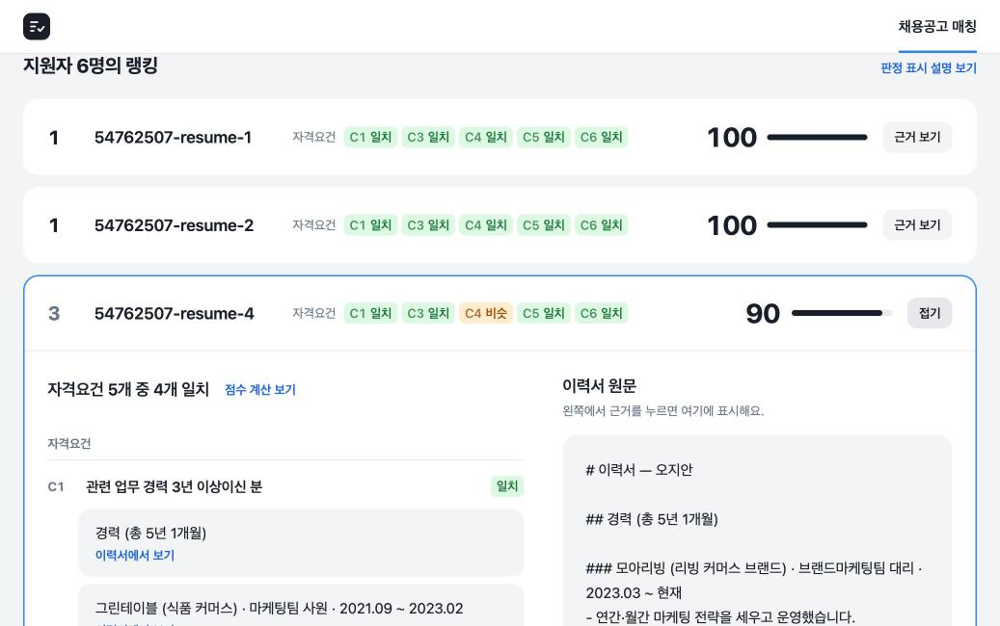
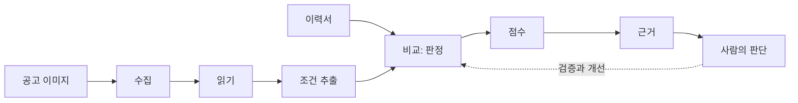
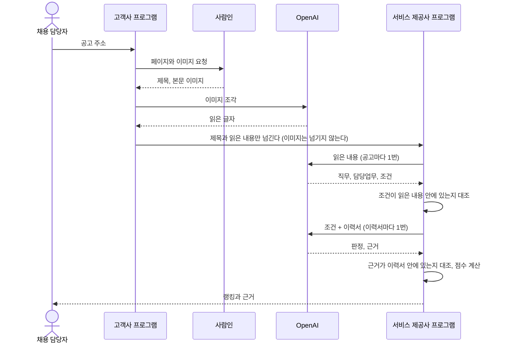
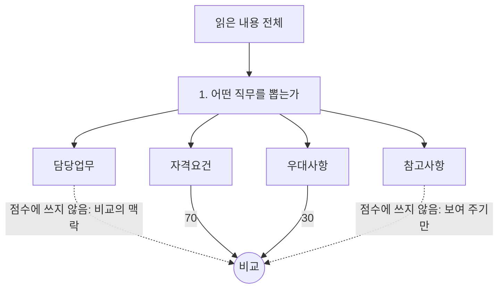
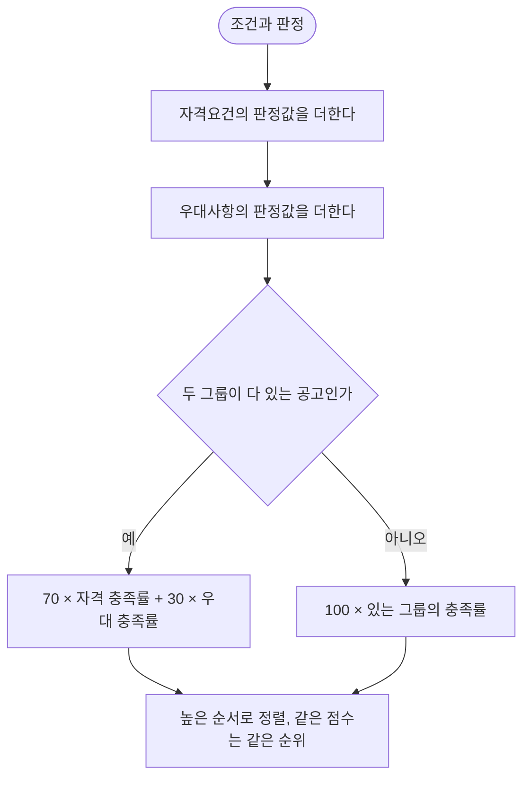
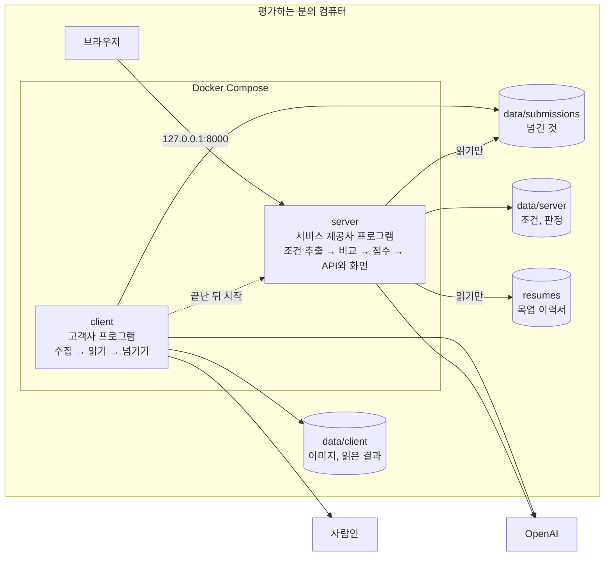
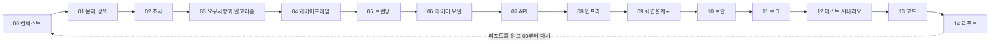

# 지원자-공고 매칭 스코어링 엔진

그룹바이에이치알 채용 과제입니다. 사람인의 이미지 공고를 가져와 읽고, 조건을 뽑고, 이력서 6명을 0~100점으로 랭킹하고, 점수의 근거를 이력서 원문과 나란히 보여 줍니다.



**이 문서를 읽는 순서**: 실행 → 결과 → 과제를 어떻게 읽었는가 → 생각이 바뀐 흐름 → 구조 → 데이터셋과 테스트 → 하지 않은 것 → 일한 방식(하네스)

실행하는 것은 모두 [`result/`](result/)에 있습니다. `docs/`는 그 결과에 이르기까지의 설계 문서입니다.

## 1. 실행 방법

```bash
git clone https://github.com/dev-tryit/groupby-harness.git
cd groupby-harness
echo "OPENAI_API_KEY=과제와_함께_주신_키" > .env
cd result
docker compose up --build
```

브라우저에서 [http://127.0.0.1:8000](http://127.0.0.1:8000) 을 엽니다.


|                      |                                                                                 |
| :-------------------- | :------------------------------------------------------------------------------- |
| 명령 하나가 하는 일          | 수집 → 읽기 → 조건 추출 → 비교 → 점수 → 화면                                                  |
| 처음 실행하는 비용           | 약 $0.016 (이미지를 읽는 비용. 조건 추출과 비교는 저장된 결과를 씁니다)                                   |
| 조건 추출과 비교도 처음부터 돌리려면 | `result/data/server/`의 `features/`, `matches/`를 지우고 실행합니다. 약 $0.04              |
| 키가 없거나 공고가 마감되었을 때   | 수집과 읽기는 실패하지만, 저장된 결과로 화면은 나옵니다                                                 |
| 테스트                  | `docker compose run --rm --no-deps server python -m unittest discover -s tests` |
| 로그                   | `docker compose logs` (한 줄에 JSON 하나)                                            |


## 2. 결과


| 공고                          | 완벽 2명    | 부분 3명      | 미스매칭 1명 |
| :--------------------------- | :-------- | :---------- | :------- |
| 마케팅 (압타바이오, 서술형 조건, 이미지 3장) | 100, 100 | 90, 90, 80 | 0       |
| 회계 (삼천리, 정형 조건, 이미지 1장)     | 100, 100 | 77, 77, 70 | 0       |


- 두 공고는 같은 코드와 같은 프롬프트 두 개로 처리했습니다. 직군이나 스킬의 이름은 코드에 없습니다.
- 점수는 코드가 계산합니다. LLM은 숫자를 내지 않습니다.
- 근거는 이력서의 구절입니다. 그 구절이 이력서에 실제로 있는지 코드가 대조합니다.

## 3. 과제를 어떻게 읽었는가

과제는 세 가지를 비워 두었습니다. "잘 매칭됐다"가 무엇인지, "부분 매칭"은 무엇이 부분인지, 0~100점이 무엇을 뜻하는지입니다. 이것을 채우는 것이 문제 정의라고 보았습니다.

> 공고(비정형 이미지)에서 조건을 뽑고, 그 조건과 이력서를 비교해 지원자가 조건을 충족하는지 판정하고, **사람이 확인할 수 있는** 점수와 근거를 내는 문제입니다.




| 과제의 문장           | 읽은 의도                  | 그래서 한 것                     |
| :---------------- | :---------------------- | :--------------------------- |
| 우선순위를 정해서, 컴팩트하게 | 무엇을 하고 무엇을 버렸는지를 본다    | 우선순위가 곧 답안이라고 보았습니다         |
| 직군 무관, 하드코딩 금지   | 직군에 대한 이해 없이 일반화하는가    | 직군이 아니라 **조건의 형식**을 일반화했습니다 |
| 0\~100점과 근거      | 채용 담당자가 점수를 믿을 수 있는가   | 점수는 코드가, 근거는 원문의 구절로        |
| 고객사를 거쳐서 들어오는 구조 | 코드 밖의 사업 감각            | 프로그램을 둘로 나누었습니다             |
| 예산 약 $5          | LLM을 어디에 쓰고 어디에 쓰지 않는가 | 결정론적으로 할 수 없는 일에만 씁니다       |


## 4. 생각이 바뀐 흐름: 가설에서 결론까지

### 4.1 법: "크롤링을 없애라"가 아니라 "누가 가져오는가"

- **가설**: 과제의 "고객사를 거쳐서"는 가져오는 주체를 고객사로 바꾸라는 뜻입니다. 기준은 데이터가 어디에 있느냐가 아니라 누가 가져와서 넣었느냐입니다.
- **결론**: 프로그램을 둘로 나누고, 이 서비스를 고객사를 위한 B2B 서비스로 정의했습니다. 과제는 구현하지 않아도 된다고 했지만, 구조가 코드의 경계가 되도록 만들었습니다.



- 서비스 제공사 프로그램은 사람인에 접속하지 않습니다. 이미지도 받지 않습니다.
- 실제 서비스라면 두 쪽의 OpenAI 키가 다릅니다. 과제가 준 키가 하나라서 같은 키를 쓴다고 가정했습니다.
- 법과 판례를 조사한 내용은 [`docs/02_research/law/law.md`](docs/02_research/law/law.md)에 있습니다. 법률 자문이 아니라 공개된 자료를 읽은 해석입니다.

### 4.2 핵심은 수집이 아니라 읽기와 조건 추출

- **가설**: 공고는 고객사가 넘기는 것이므로 수집은 핵심이 아닙니다. 조건이 공고와 지원자를 잇는 중심축입니다. 조건에서 틀리면 비교, 점수, 근거가 모두 틀립니다.
- **결론**: 수집은 공고 주소 하나에서 본문 이미지를 가져오는 데까지만 만들었습니다. 힘은 읽기와 조건 추출에 실었습니다.


| 고민              | 재 본 것                                                                           | 결론                                                       |
| :--------------- | :------------------------------------------------------------------------------- | :-------------------------------------------------------- |
| 무엇으로 읽을까        | 실제 공고 8건의 조건 줄 64개. PaddleOCR 63개, `gpt-4.1-mini` 64개. 띄어쓰기와 표의 칸은 비전 모델만 지켰습니다 | `gpt-4.1-mini`, 온도 0, 이미지를 잘라서 읽기                        |
| 큰 모델이 필요한가      | 작은 모델이 "반려동물 양육"을 자격요건으로 잘못 뽑았습니다                                               | 큰 모델로 바꾸지 않고, 판단보다 생각을 먼저 쓰게 했습니다(CoT). 같은 결과에 비용은 약 1/5 |
| 읽기와 추출을 한 번에 할까 |                                                                                 | 분리했습니다. 나중에 OCR의 비용을 줄이는 데 도움이 된다고 보았습니다                 |


### 4.3 직군이 아니라 조건의 형식을 일반화

- **가설**: 세상에 어떤 직군이 얼마나 있는지 알 수 없습니다. 그리고 회사가 원하는 것은 채용 공고에 배어 있습니다. 그래서 공고가 기준입니다.
- **생각의 변화**: 처음에는 조건을 자격요건/경험/성향의 묶음과 필수/우대의 두 축으로 보았습니다. 용어가 헷갈렸고, 점수에 필요한 것은 세 그룹뿐이었습니다.
- **결론**: 먼저 어떤 직무를 뽑는지를 알고, 그 직무를 기준으로 가릅니다.



- 담당업무는 자격요건과 겹칩니다. 점수에 넣으면 같은 것을 두 번 세게 됩니다.
- 개인 사정(병역, 반려동물 양육 등)과 성향은 참고사항입니다. 서류전형은 서류로 적합도를 판단하는 것이고, 성향은 면접에서 직접 보고 판단하는 것이라고 보았습니다.
- 읽은 내용 전체를 버리지 않습니다. 공고의 어느 칸에 무엇이 있을지를 미리 정해 두지 않기 위해서입니다.

### 4.4 LLM의 숫자는 점수가 아니다

- **가설**: LLM이 내놓은 숫자는 그럴듯한 말일 뿐 실제 수치가 아닙니다. 그리고 할루시네이션은 없앨 수 없습니다.
- **결론**: LLM은 판정과 근거만 냅니다. 숫자는 코드가 계산합니다. 지어낸 것은 없애는 것이 아니라 잡아냅니다.


| LLM이 내는 것           | 코드가 하는 것                                 |
| :------------------- | :---------------------------------------- |
| 조건 (공고의 글자 그대로)     | 읽은 내용 안에 글자 그대로 있는지 대조                   |
| 판정 (일치, 비슷, 다름)과 이유 | 판정값을 더해 점수와 순위를 계산                       |
| 근거 (이력서의 구절)        | 이력서 안에 글자 그대로 있는지 대조. 없으면 그 판정을 믿지 않고 0점 |


- 구절은 있는데 판정을 뒷받침하지 않는 경우는 코드로 잡지 못합니다. 그래서 화면에서 근거를 이력서 원문과 나란히 보여 줍니다.

### 4.5 점수: 무엇을 뜻하는가

과제는 0~100점이 무엇을 뜻하는지 정하지 않았습니다. 그래서 점수를 만들기 전에 세 가지를 정해야 했습니다.

| 정해야 했던 것 | 뜻 |
| :- | :- |
| 판정 | 조건 하나를 이력서가 채웠는지에 대한 답입니다. LLM이 냅니다 |
| 판정값 | 판정을 숫자로 바꾼 것입니다. 코드가 정해 둔 값입니다 |
| 합치는 식 | 조건마다의 판정값을 지원자 한 명의 0~100점으로 만드는 방법입니다 |

- **가설**: 점수는 사람이 납득하고 직접 검산할 수 있어야 합니다. 그리고 공고를 쓴 사람은 자격요건과 우대사항을 나누어 적었을 뿐, 항목마다 점수를 매기지 않았습니다.

- **생각의 변화**: 세 가지를 처음에 이렇게 두었다가 바꿨습니다.

| 정한 것 | 처음 | 바꾼 것 | 이유 |
| :- | :- | :- | :- |
| 판정 | 네 가지 (충족, 일부 충족, 미충족, 알 수 없음) | 세 가지 (일치, 비슷, 다름) | "알 수 없음"은 이력서에 적혀 있지 않은 경우였습니다. 이것을 다름으로 두고, 화면에 "이력서에 적혀 있지 않음"이라고 따로 표시합니다 |
| 합치는 식 | 충족한 조건의 개수를 더한다 | 그룹마다 비율(충족률)을 낸다 | 개수를 더하면 조건을 많이 적은 그룹이 점수를 좌우합니다. 비율로 하면 조건이 3개인 공고든 5개인 공고든 다 채우면 100점입니다 |
| 합치는 식 | 자격요건을 다 채워야 우대사항의 점수가 붙는다 (문턱) | 두 그룹의 충족률에 70과 30을 곱해 더한다 | 자격요건을 다 맞추는 것이 꼭 중요한 것은 아니라고 판단했습니다. 두 그룹의 무게 차이는 7 대 3에 이미 들어 있습니다 |

- **결론**

```
판정값       일치 2, 비슷 1, 다름 0
충족률       = 그 그룹의 판정값을 더한 것 ÷ (그 그룹의 조건 수 × 2)
점수         = 70 × 자격 충족률 + 30 × 우대 충족률      (우대사항이 없는 공고는 100 × 자격 충족률)
```

회계 공고(자격요건 3개, 우대사항 2개)의 예입니다.

| 지원자 | 자격 충족률 | 우대 충족률 | 계산 | 점수 |
| :- | :- | :- | :- | :- |
| 다 갖춤 | 6/6 | 4/4 | 70 + 30 | 100 |
| 회계사 등록 없음(다름), 우대사항 다 있음 | 4/6 | 4/4 | 46.7 + 30 | 77 |
| 자격요건 다 갖춤, 우대사항이 적혀 있지 않음 | 6/6 | 0/4 | 70 + 0 | 70 |



- 점수의 뜻은 "이 공고가 적은 조건을 이력서에서 확인한 정도"입니다. 같은 공고의 지원자끼리만 비교합니다.
- 자격요건은 min(최소한 갖춰야 하는 선), 우대사항은 max(가장 바라는 모습)로 보았습니다.
- 같은 그룹 안의 조건은 동등합니다. 공고를 쓴 사람이 항목마다 점수를 매긴 것이 아니기 때문입니다.
- 알고 고른 것: 위 표처럼 자격요건 하나가 빠지고 우대사항을 다 갖춘 사람(77점)이, 자격요건만 다 갖춘 사람(70점)보다 위에 옵니다.

### 4.6 매칭에는 정답이 없다. 그래서 근거와 가설

- **가설**: 매칭이 옳은지의 기준은 사람의 판단입니다. 풀어야 하는 문제는 "맞음을 증명한다"가 아니라 "사람이 확인할 수 있게 한다"입니다.
- **결론**: 7 대 3도, "비슷하다"의 기준도 정답이 아니라 가설입니다. 값을 지금 완벽하게 정하는 것보다, 가설을 기록해 두고 채용 담당자의 피드백으로 확인해 가는 것(데이터 플라이휠)이 더 중요하다고 보았습니다.
- **생각의 변화**: 피드백을 받는 화면까지 만들어야 한다고 생각했습니다. 과제의 요구사항에 없어서 만들지 않고, 가설과 확인할 방법을 글로 남겼습니다([`docs/03_prd/prd.md`](docs/03_prd/prd.md) 11장).
- "비슷하다"의 기준은 튜닝해 가는 것으로 보고, do와 don't로 프롬프트에 적어 관리합니다.

## 5. 구조



- 두 컨테이너가 함께 보는 폴더는 `data/submissions` 하나뿐입니다. 4.1의 경계가 구성으로 지켜집니다.
- 점수와 순위는 저장하지 않습니다. 화면이 물을 때마다 판정에서 계산합니다.

```
result/
  docker-compose.yml     실행
  backend/groupby/
    client/              고객사 프로그램 (수집, 읽기)
    server/              서비스 제공사 프로그램 (extraction, matching, scoring, viewing)
    shared/              두 프로그램 사이에 넘기는 것의 모양
  backend/tests/         테스트
  frontend/index.html    화면
  resumes/               목업 이력서 12명과 가설
  data/server/           저장해 둔 조건과 판정
```


| 과제의 요구사항            | 위치                                                                                        |
| :------------------- | :----------------------------------------------------------------------------------------- |
| 1. 비공식 크롤링, 이미지 공고  | `backend/groupby/client/adapters/outbound/saramin_http.py`                                |
| 2. 이미지 파싱 → 구조화된 조건 | `client/reading/`, `server/extraction/`, `data/server/features/`                          |
| 3. 0\~100점과 랭킹      | `server/scoring/domain.py`                                                                |
| 4. 사람이 읽는 근거        | `server/matching/`, 화면의 "근거 보기"                                                           |
| 5. 직군 무관 일반화        | `server/adapters/outbound/prompts/` (프롬프트 두 개)                                            |
| 6. 명령 하나로 실행        | `docker-compose.yml`. API는 `GET /api/postings`, `/api/postings/{id}`, `/api/resumes/{id}` |
| 7. 간단한 UI           | `frontend/index.html`                                                                     |
| 8. 법적 우회 구조         | 이 문서의 4.1과 5                                                                              |


## 6. 목업 이력서 데이터셋

[`result/resumes/`](result/resumes/)에 있습니다. 이력서마다 검증하려는 가설을 `expectations.json`에 적었습니다.

- 골든셋은 정답이 아니라 가설을 증명하는 데이터입니다. 어떤 공고와 이력서를 고르느냐가 코드의 성능을 결정한다고 보았습니다.
- 공고는 추출기를 시험하므로 서로 다르게 생긴 것을 골랐습니다(서술형 줄글과 정형 표). 이력서는 스코어링을 시험하므로 한 군데만 다른 이력서끼리 견줄 수 있게 만들었습니다.
- 이력서가 어떻게 쓰일지 모르므로 형태도 다르게 만들었습니다(항목형, 서술형, 성과형, 요약형).
- 공고는 구인구직 시장에서 유의미한 직군에서 골랐습니다. 마케팅은 스타트업 공고에서 비개발 직군 가운데 가장 많고, 회계가 속한 경영지원은 지원자가 가장 몰리는 직군입니다. 회계 공고는 공인회계사를 뽑는 공고라 범용성이 약합니다.


이력서를 만든 방법은 이렇습니다. 1번이 기준선이고, 나머지는 1번에서 **한 군데만** 바꿨습니다. 그래서 점수가 달라지면 바꾼 그 한 군데 때문이라고 말할 수 있습니다. 가설은 "이렇게 바꾸면 이렇게 나와야 한다"는 기대이고, 결과가 그 기대대로 나왔는지를 봅니다.

**마케팅 공고** (자격요건 5개, 우대사항 없음. 조건 하나가 20점)

| 이력서 | 유형 | 1번에서 바꾼 것 | 검증하려는 가설 | 결과 |
| :- | :- | :- | :- | :- |
| 1 | 완벽 | 기준선. 공고의 표현 그대로 다 갖췄다 | 다 갖추면 100점이다 | 100 |
| 2 | 완벽 | 내용은 같고, 다른 말로 칸 없이 줄글로 썼다 | 표현과 형태가 달라도 판정이 같다 | 100 |
| 3 | 부분 | 지표로 개선안을 낸 경험만 뺐다 | 조건 하나가 빠지면 그 조건만 내려간다 | 80 (그 조건만 다름) |
| 4 | 부분 | 캠페인을 실행만 했고 기획과 성과 분석은 하지 않았다 | 조건의 일부만 채운 것을 일치로 보지 않는다 | 90 (그 조건만 비슷) |
| 5 | 부분 | 경력을 2년 6개월로 줄였다 (조건은 3년 이상) | 조금 모자란 것을 일치로 보지 않는다 | 90 (그 조건만 비슷) |
| 6 | 미스매칭 | 반려동물 용품 매장의 판매직. 브랜드, 캠페인, 매출이라는 단어가 나온다 | 단어만 겹치는 사람을 걸러낸다. 참고사항(반려동물 양육)은 갖췄어도 점수에 들어가지 않는다 | 0 |

**회계 공고** (자격요건 3개, 우대사항 2개)

| 이력서 | 유형 | 1번에서 바꾼 것 | 검증하려는 가설 | 결과 |
| :- | :- | :- | :- | :- |
| 1 | 완벽 | 기준선. 자격요건과 우대사항을 다 갖췄다 | 다 갖추면 100점이다 | 100 |
| 2 | 완벽 | 내용은 같고 성과 위주로 썼다. 자격이 학력보다 뒤에, 다른 칸 이름 아래에 있다 | 표현과 형태가 달라도 판정이 같다 | 100 |
| 3 | 부분 | 자격요건은 다 갖췄지만 짧게 써서 우대사항에 대한 내용이 없다 | 적지 않은 것을 없는 것과 가려서 보여 준다 | 70 (우대사항 둘 다 "이력서에 적혀 있지 않음") |
| 4 | 부분 | 회계사 등록만 뺐다 | 자격요건 하나가 빠지면 그 조건만 내려간다 | 77 (그 조건만 다름) |
| 5 | 부분 | 감사 경력을 2년으로 줄였다 (조건은 3~5년) | 조금 모자란 것을 일치로 보지 않는다 | 77 (그 조건만 다름) |
| 6 | 미스매칭 | 일반 회사의 회계 담당자. 회계, 외부감사, SAP라는 단어가 나온다 | 단어만 겹치는 사람을 걸러낸다 | 0 |

가설대로 나오지 않았거나 눈여겨볼 곳은 셋입니다.

- **"조금 모자란 것"의 판정이 두 공고에서 다릅니다.** 마케팅의 5번(3년 이상에 2년 6개월)은 비슷이고, 회계의 5번(3~5년에 2년)은 다름입니다. "비슷하다"의 기준이 튜닝해 가야 하는 것이라는 4.6의 가설이 드러난 자리입니다.
- **회계의 6번은 SAP를 실제로 써 본 사람인데 0점입니다.** LLM은 그 조건을 일치로 판정했지만, 근거로 낸 구절이 이력서의 글자와 달라서 코드가 그 판정을 믿지 않았습니다. 화면에는 "근거를 확인하지 못함"으로 나옵니다. 지어낸 근거를 잡으려는 대조가 맞는 판정도 떨어뜨릴 수 있습니다.
- **회계의 3번(70점)이 4번, 5번(77점)보다 낮습니다.** 미리 적어 둔 기대는 "자격요건을 다 갖춘 3번이 낮지 않다"였습니다. 4.5에서 문턱 식을 버리면서 판단이 바뀐 자리입니다. 골든셋은 결과에 맞춰 고치지 않고 그대로 두었습니다.

## 7. 테스트

LLM을 부르지 않는 테스트 37개입니다. 시스템이 깨지면 안 되는 곳을 골랐습니다.


| 고른 케이스                                                           | 이유                          |
| :---------------------------------------------------------------- | :--------------------------- |
| 근거의 글자가 하나만 달라도, 떨어진 구절을 이어 붙여도 믿지 않는다                           | 가장 걱정한 것이 LLM이 지어내는 것입니다    |
| 근거를 확인하지 못한 판정은 0점이다                                             | 확인하지 못한 것에 점수를 주지 않습니다      |
| 개인 사정은 공고가 필수 칸에 적었어도 참고사항이다                                     | 능력과 상관없는 것으로 순위가 바뀌면 안 됩니다  |
| 점수의 성질: 0\~100 안에 있다, 판정이 좋아지면 점수가 내려가지 않는다, 다른 지원자에 따라 달라지지 않는다 | 값 몇 개가 아니라 식이 지켜야 하는 것을 봅니다 |
| 우대사항이 없는 공고는 자격요건이 100점 전부를 갖는다                                  | 공고가 적지 않은 것으로 점수를 깎지 않습니다   |
| 긴 이미지를 자를 때 글자가 있는 줄을 가로지르지 않는다                                  | 읽기에서 틀리면 뒤가 모두 틀립니다         |
| API: 없는 번호는 404, 모양이 어긋난 번호는 400                                 | 화면이 묻는 것의 경계입니다             |


LLM의 판정 자체는 이 테스트로 확인하지 않습니다. 골든셋의 가설과 결과를 견주어 봅니다(6장).

## 8. 설계 결정과 트레이드오프


| 결정                             | 버린 대안           | 얻은 것                        | 잃은 것                                               |
| :------------------------------ | :--------------- | :--------------------------- | :-------------------------------------------------- |
| 조건마다 판정한다                      | 공고와 이력서 전체의 유사도 | 근거를 댈 수 있고, 필수와 우대를 가릅니다    | LLM 호출이 이력서마다 한 번 듭니다                              |
| 조건 추출과 비교를 따로 부른다              | 한 번에 부르기        | 모든 지원자에게 같은 조건이 적용됩니다       | 공고마다 호출이 한 번 더 듭니다                                 |
| 코드가 점수를 계산한다                   | LLM이 점수를 내기     | 검산할 수 있습니다                  | 식의 값(7 대 3)을 우리가 정해야 합니다                           |
| 비전 모델로 읽는다                     | 로컬 OCR 엔진       | 띄어쓰기와 표의 칸이 지켜집니다           | 읽는 데 비용이 듭니다                                       |
| HTTP 요청으로 수집한다                 | 브라우저 자동화        | 평가하는 분의 컴퓨터에서 명령 하나로 돕니다    | 차단과 페이지 변경에 약합니다                                   |
| 결과를 저장하고 다시 만들지 않는다            | 매번 다시 만들기       | 실행마다 결과가 같고 비용이 들지 않습니다     | 지우지 않으면 LLM이 다시 돌지 않습니다                            |
| 조건과 판정을 저장소에 넣는다               | 아무것도 넣지 않기      | 수집이 실패해도 화면이 나옵니다           | 조건의 글자가 public 저장소에 들어갑니다. 이미지와 읽은 내용 전체는 넣지 않았습니다 |
| 파일에 저장하고 표준 라이브러리의 HTTP 서버를 쓴다 | DB, 웹 프레임워크     | 의존성이 적고 결과를 파일로 열어 볼 수 있습니다 | 양이 늘면 바꿔야 합니다                                      |


자세한 이유는 각 단계의 `DECISIONS.md`에 있습니다.

## 9. 하지 않은 것


| 하지 않은 것                 | 이유                                                       |
| :----------------------- | :-------------------------------------------------------- |
| 크롤링에 힘주기 (목록 수집, 차단 회피) | 공고는 고객사가 넘기는 것이라 핵심이 아닙니다                                |
| 피드백을 받는 화면              | 과제의 요구사항에 없습니다. 방침은 글로 남겼습니다                             |
| 인증                      | 요구사항에 없고, 명령 하나로 실행하는 데 계정이 끼어듭니다. 포트는 `127.0.0.1`에만 엽니다 |
| 성향을 점수로 계산하기            | 면접에서 보는 것이라고 보았습니다                                       |
| 클라우드 인프라, CI/CD         | 평가하는 분에게 계정과 키가 필요해집니다. 로컬(Docker Compose)만 만들었습니다       |
| 필터링                     | 공고를 모든 이력서와 비교할 수는 없다고 봅니다. 이 과제에서는 공고마다 6명이 주어집니다       |
| 에이전트 팀의 검증              | 규칙은 정했고 돌리지는 못했습니다                                       |


설계와 코드가 아직 어긋난 곳도 있습니다. 로그는 설계한 사건 가운데 일부만 남기고, 공고마다의 trace id는 고객사 프로그램에서 넘기지 않습니다. 이력서 번호는 화면에 `공고 번호-resume-1`처럼 나옵니다.

## 10. 일한 방식: 하네스

초점은 두 가지였습니다. 앞으로 계속 쓸 하네스를 만드는 것과, 문제를 잘 해결하는 것입니다. 코드보다 하네스를 먼저 만든 것은 의도한 순서이고, 커밋 기록에 그대로 남아 있습니다.




| 규칙                                                      | 이유                                     |
| :------------------------------------------------------- | :-------------------------------------- |
| 앞 단계의 산출물이 뒤 단계의 입력이다. 뒤 단계로 앞 단계를 고치지 않는다              | 설계와 코드가 서로를 제멋대로 고치면 무엇이 기준인지 알 수 없습니다 |
| 단계마다 설계 문서 하나와 수정 기록(`DECISIONS.md`) 하나                 | 문서는 최신만 담고, 왜 바뀌었는지는 기록에서 봅니다          |
| 단계마다 표현하는 형식을 정했다 (시퀀스, 액티비티, 배치 다이어그램, 동작하는 HTML)      | 글보다 한눈에 보이는 형식이 낫습니다                   |
| 지침(`AGENTS.md`)은 폴더마다 두고 필요할 때만 읽는다                     | 불필요한 토큰을 쓰지 않습니다                       |
| 커밋은 사람이 두 번 허용한다 ([`commit-reports/`](commit-reports/)) | 에이전트가 임의로 커밋하지 않습니다                    |
| 결정은 사람이 한다. 가설과 지시를 구분한다                                | 에이전트의 추측이 제 가설에 섞이지 않게 합니다             |
| 코드는 헥사고날 아키텍처, 프론트엔드·백엔드·인프라를 폴더로 나눈다                   | 테스트가 쉽고, 서로 얽히지 않습니다                   |


`docs/13_code/`의 세 폴더는 서브모듈(별도 레포)입니다. 평가하실 때 서브모듈을 받지 않아도 되도록, 실행에 필요한 것을 `result/`에 복사해 두었습니다.

## 11. 과제를 하면서 든 생각

- 매칭이 옳은지는 어떻게 증명할 수 있는가를 고민했습니다. 매칭에는 객관적인 정답이 없고, 골든셋은 제가 붙인 딱지입니다. 진짜 검증은 사람들에게 물어야 합니다. 그래서 점수보다 근거가 중요하다고 보았습니다.
- 점수의 값(자격요건과 우대사항의 비율, 비슷을 몇 점으로 볼지)을 정하면서 계속 고민했습니다. 이 값들은 정답이 아니라 가설이라고 보았습니다. 그래서 고민한 것과 가설을 기록해 두고, 나중에 채용 담당자의 피드백으로 확인하고 고쳐 가는 것이 값을 지금 완벽하게 정하는 것보다 중요하다고 보았습니다.
- 검증까지 가고 그 결과를 나중에 데이터로 쓰려면, 사람의 판단을 받는 UI/UX까지 표현해서 데이터 플라이휠이 굴러가게 만들어야 한다고 생각했습니다.
- "비슷하다"의 기준을 튜닝하는 지점으로 직군 지식의 온톨로지를 만드는 아이디어가 번뜩였습니다. 직군이 정해지지 않은 상태에서는 관계의 틀(같음, 포함, 인접)만 정해 두고, 사람이 동의한 판정을 선으로 쌓아 가는 방식을 떠올렸습니다. 이 과제에는 해당하지 않는다고 보고 아이디어로만 남깁니다.
- 구조를 많이 만드는 것이 중요하다고 보지 않았습니다. 과제를 충족시키는 최소한의 구조면 되고, 요구사항은 점진적으로 맞춰 갑니다. 지금까지 만든 것은 그 가운데 핵심이 되는 코어 프로그램입니다.