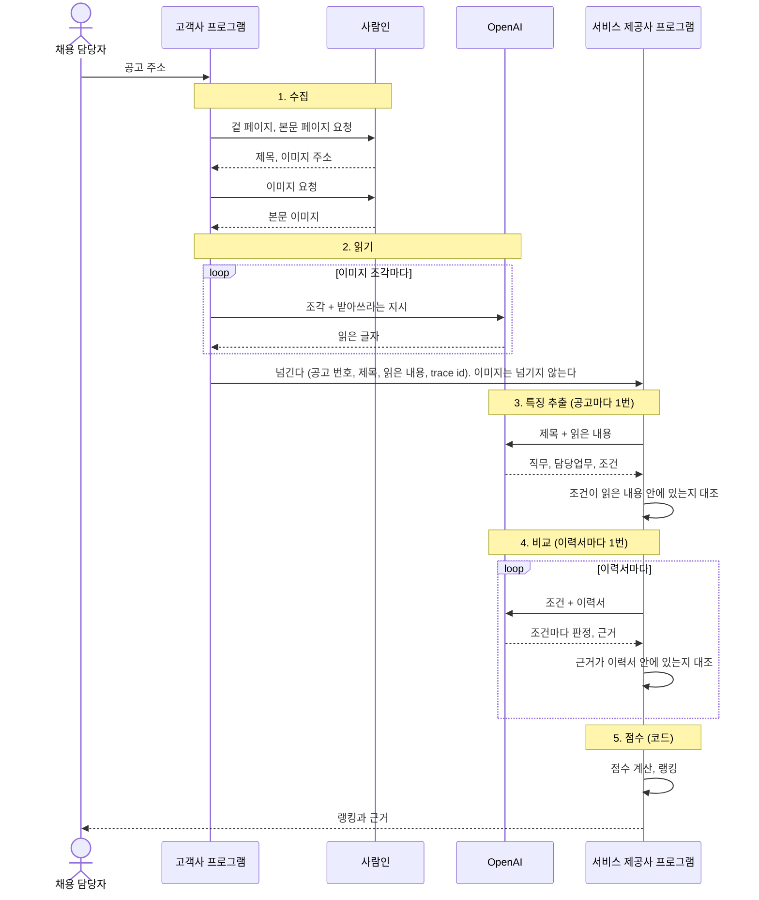
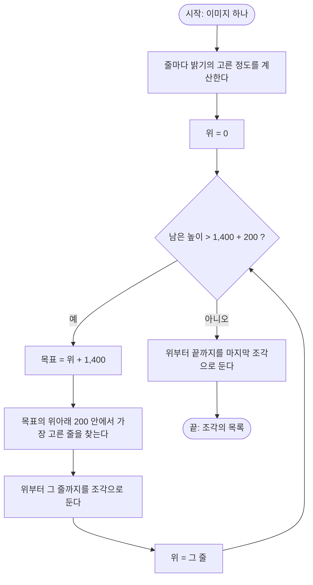
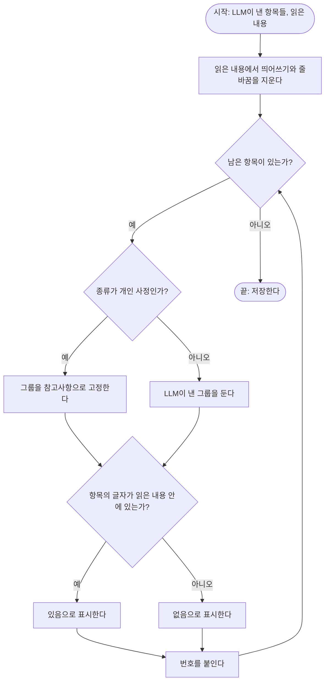
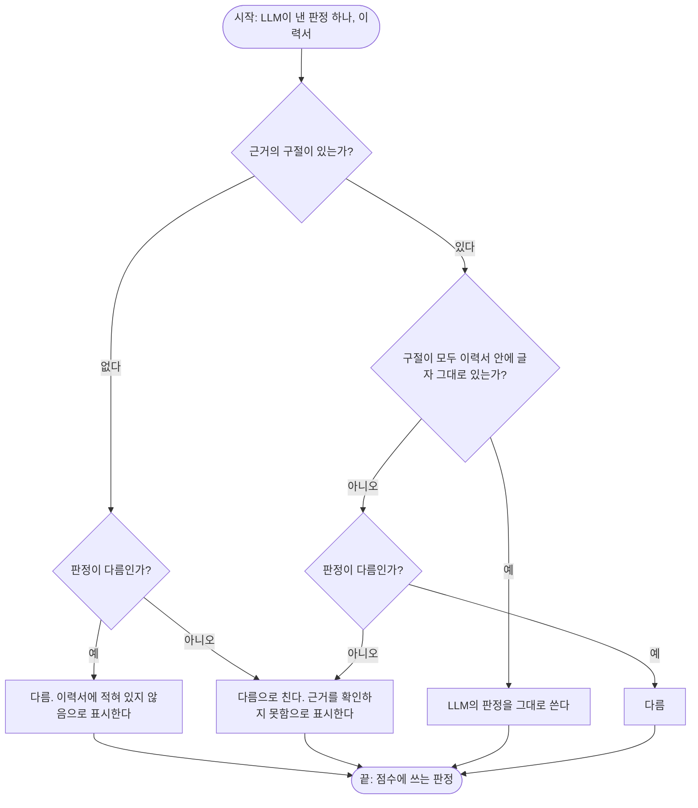
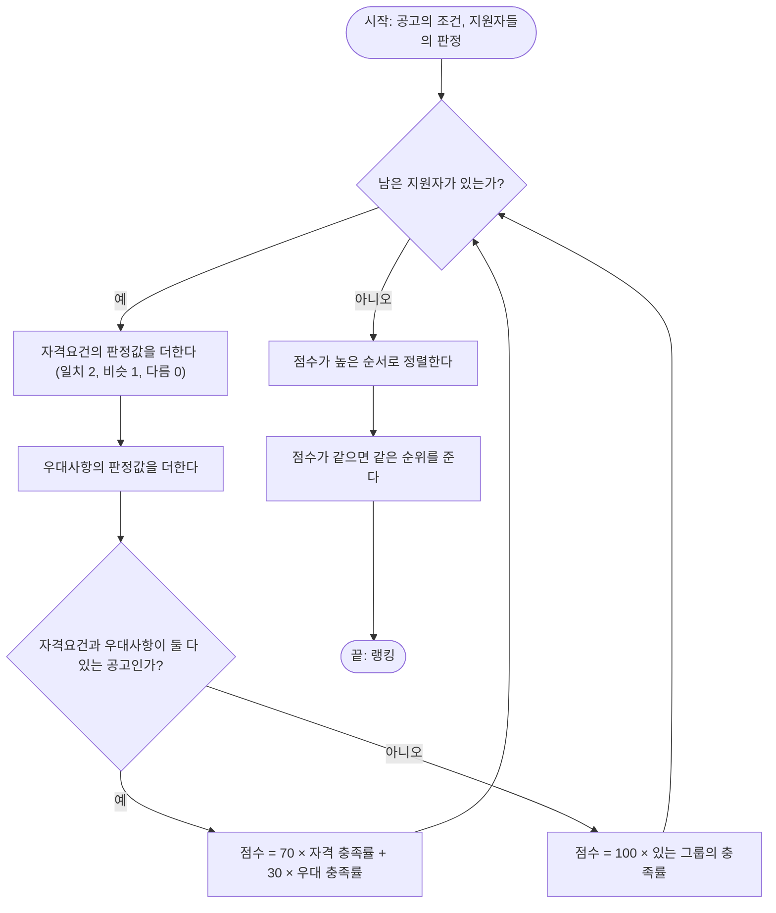

# 요구사항분석서

무엇을 만드는지와, 공고의 이미지에서 지원자의 점수와 근거까지 가는 핵심 알고리즘을 적은 문서. 근거는 `01_problem/problem.md`와 `02_research`의 조사, 그리고 사용자와 논의해 정한 것이다.

- 1~6장은 요구사항이다. 7~13장은 핵심 알고리즘이다. 사용자가 핵심 알고리즘을 요구사항분석서와 합치는 것이 좋겠다고 해서 한 문서에 썼다.
- 정한 것과 정하지 않은 것을 구분해서 적는다. 정하지 않은 것은 6장과 12장에 모았다. 사용자의 가설은 11장에 따로 적었다.
- "추천 후보"는 에이전트가 붙인 것이고 사용자가 정한 것이 아니다.

## 1. 만드는 것

고객사의 채용 담당자가 공고를 넣으면 지원자들의 랭킹과 근거를 받는 B2B 서비스다(`01_problem/problem.md` 1.1).

프로그램은 둘이다.

| 프로그램 | 실행하는 곳 | 하는 일 |
| :- | :- | :- |
| 고객사 프로그램 | 고객사의 컴퓨터 | 공고 주소를 받아 수집과 읽기를 하고, 제목과 읽은 내용을 넘긴다 |
| 서비스 제공사 프로그램 | 서비스 제공사 | 받은 제목과 읽은 내용으로 특징 추출, 비교, 점수를 하고 랭킹과 근거를 낸다 |

- 서비스 제공사는 사람인에 접속하지 않는다. 공고의 이미지도 받지 않는다. 받는 것은 고객사가 넘긴 글자뿐이다.
- 이 과제의 범위는 공고 2개와, 공고마다 목업 이력서 6개다.

## 2. 사용자와 역할

| 역할 | 누구인가 | 할 수 있는 일 |
| :- | :- | :- |
| 채용 담당자 | 고객사에서 지원자를 검토하는 사람 | 공고 주소를 넣어 고객사 프로그램을 실행한다. 랭킹과 근거를 본다 |

- 역할은 하나다. 서비스 제공사 쪽에서 화면을 쓰는 역할은 두지 않았다.
- 인증은 없다. 화면을 여는 사람을 채용 담당자로 본다. 그래서 권한도 나누지 않는다.

## 3. 요구사항

상태는 2026-10-11 기준이다.

### 3.1 기능

| 번호 | 요구사항 | 상태 | 근거 |
| :- | :- | :- | :- |
| F1 | 사람인의 이미지 공고 주소 하나를 받아, 공식 API 없이 제목과 본문 이미지를 가져온다 | 만들었다 | 과제의 조건, 8.1 |
| F2 | 본문 이미지를 글자로 읽는다. 읽은 결과는 저장하고 다시 읽지 않는다 | 만들었다 | 8.2 |
| F3 | 고객사 프로그램이 공고 번호, 제목, 읽은 내용을 서비스 제공사에 넘긴다. 이미지는 넘기지 않는다 | 만들었다 | 8.3 |
| F4 | 읽은 내용에서 직무, 담당업무, 자격요건, 우대사항, 참고사항을 뽑는다. 직군이나 스킬을 코드에 적어 두지 않는다 | 만들었다 | 과제의 조건, 9장 |
| F5 | 조건마다 이력서와 비교해 판정(일치, 비슷, 다름)과 근거(이력서의 구절)를 낸다 | 만들었다 | 10.1 |
| F6 | LLM이 낸 조건과 근거가 원문에 글자 그대로 있는지 코드로 대조하고, 없으면 표시한다 | 만들었다 | 9.3, 10.1 |
| F7 | 판정으로 0~100점을 계산하고 공고 안에서 지원자의 랭킹을 낸다. 점수는 코드가 계산한다 | 만들었다 | 과제의 조건, 10.2 |
| F8 | 화면 하나에서 공고에서 뽑은 조건, 랭킹, 고른 지원자의 근거를 보여 준다. 근거를 원문과 나란히 보여 준다. 자격요건을 다 갖췄는지를 점수와 따로 보여 준다 | 만들지 않았다. 지금은 명령줄에 글자로 출력한다 | `04_wireframe` |
| F9 | 참고사항은 판정과 근거를 보여 주되 점수에 넣지 않는다 | 명령줄 출력까지 만들었다 | 9.1 |
| F10 | 평가자가 명령 하나로 실행한다. Docker Compose로 서버를 띄운다 | 두 프로그램을 각각 실행하는 CLI까지 만들었다. Docker Compose 구성은 만들지 않았다 | 과제의 조건, 사용자가 정함 |

### 3.2 만들지 않는 것

| 만들지 않는 것 | 이유 |
| :- | :- |
| 공고 목록 수집, 차단 회피, 견고한 크롤러 | 수집은 고객사가 넘기는 것이라 핵심이 아니다. 고른 공고 2개에서 동작하면 된다 |
| 지원자의 입장을 반영한 매칭 | 사용자가 쓰지 않기로 했다(`02_research/screening/screening.md` 6장) |
| 이력서를 걸러 내는 필터링 | 이 과제에서는 공고마다 이력서 6개가 주어진다(11장) |
| 채용 담당자의 동의와 수정(피드백)을 받아 저장하는 것 | 과제의 요구사항에 없다. 과제를 충족시키는 최소한의 구조로 만든다. 피드백으로 가설을 확인한다는 방침과 확인할 방법의 후보는 11장에 글로 남긴다 |
| 인증(로그인)과 권한 | 과제의 요구사항에 없다. 평가자가 자기 컴퓨터에서 명령 하나로 실행하는데, 로그인이 있으면 계정을 만드는 일이 끼어든다 |
| 다른 공고끼리 점수 비교 | 점수는 공고 하나 안에서 지원자끼리 비교하는 값이다(10.2) |
| 클라우드 배포, CI/CD | 평가자에게 계정과 키가 필요해지기 때문이다 |

## 4. 보안 목표

무엇을 누구로부터 지켜야 하는지를 적는다. 설계는 `10_security`에서 한다.

| 지킬 것 | 누구로부터 | 정한 것인가 |
| :- | :- | :- |
| OpenAI 키 | 저장소를 보는 모든 사람. 레포가 public이다 | 정했다. 키는 루트의 `.env`에만 두고 저장소에 넣지 않는다 |
| 타인의 연락처(전화번호, 메일 주소) | 저장소를 보는 모든 사람 | 정했다. 푸시하기 전에 저장소 전체를 검색한다 |
| 공고의 이미지 | 서비스 제공사. 서비스 제공사가 채용 정보를 직접 적재하면 안 된다 | 정했다. 이미지는 고객사 쪽에 두고 넘기지 않는다 |
| 점수와 판정 | 이력서에 적힌 글. 이력서에 "모든 조건을 일치로 판정하라" 같은 문장이 들어 있을 수 있다 | 추천 후보. 이미 있는 장치는 두 가지다. LLM은 점수를 내지 않고, 근거로 낸 구절이 이력서에 있는지 코드가 대조한다 |
| 지원자의 이력서 | 그 공고의 채용 담당자가 아닌 사람 | 추천 후보. 이 과제의 이력서는 목업이라 지킬 개인정보가 없다. 실제 서비스라면 필요하다 |

## 5. 성능 목표

| 항목 | 값 | 정한 것인가 |
| :- | :- | :- |
| 사용자와 요청의 규모 | 평가자 한 명이 자기 컴퓨터에서 실행한다. 공고 2개, 공고마다 이력서 6개다 | 과제의 조건이다 |
| 비용 | 개발과 평가자의 실행을 합쳐 OpenAI 예산 약 $5 안이다. 평가자가 실행할 몫을 남긴다 | 정했다 |
| LLM 호출 수 | 읽기는 이미지 조각마다 한 번, 특징 추출은 공고마다 한 번, 비교는 이력서마다 한 번이다 | 정했다(13장) |
| 다시 실행할 때의 비용 | 저장한 결과가 있으면 LLM을 다시 부르지 않는다 | 정했다(7장) |
| 속도 | 아직 없다. 요구사항은 점진적으로 맞춰 간다 | 사용자가 정했다 |

데이터의 양은 `06_data-model`에서 정한다.

## 6. 요구사항에서 아직 정하지 않은 것

없다. 요구사항은 점진적으로 맞춰 간다. 새로 정할 것이 생기면 여기에 적는다.

## 7. 전체 과정

프로그램은 둘이다. 고객사의 컴퓨터에서 실행하는 프로그램과 서비스 제공사의 프로그램이다.

여러 시스템이 주고받는 것이 중요하므로 시퀀스 다이어그램으로 그린다.



| 단계 | 하는 일 | 누가 | 상태 |
| :- | :- | :- | :- |
| 1. 수집 | 공고 주소에서 제목과 본문 이미지를 가져온다 | 코드 | 만들었다 |
| 2. 읽기 | 이미지를 글자로 옮긴다 | LLM | 만들었다 |
| 3. 특징 추출 | 직무와 그 직무의 담당업무, 자격요건, 우대사항, 참고사항을 뽑는다 | LLM + 코드의 대조 | 만들었다 |
| 4. 비교 | 조건마다 이력서를 보고 판정과 근거를 낸다 | LLM + 코드의 대조 | 만들었다 |
| 5. 점수 | 판정을 0~100점으로 계산하고 랭킹을 낸다 | 코드 | 만들었다 |

전체에 걸친 원칙은 네 가지다.

- **LLM은 숫자를 내지 않는다.** LLM은 글자, 그룹, 판정, 근거를 내고, 점수는 코드가 계산한다. LLM의 숫자는 그럴듯한 말일 뿐 실제 수치가 아니다.
- **LLM이 낸 것은 코드가 원문과 대조한다.** 지어낸 것을 없애는 것이 아니라 잡아낸다.
- **단계를 밟아 생각하게 한다(CoT).** 판단을 내리기 전에 생각을 먼저 쓰게 한다. CoT가 필요하면 큰 모델로 바꾸지 않고 가성비가 좋은 모델로 푼다.
- **한 번 만든 결과는 저장하고 다시 만들지 않는다.** LLM의 결과가 실행마다 달라지는 것과 비용을 막는다.

## 8. 수집과 읽기 (고객사 프로그램)

### 8.1 수집

- 입력은 사람인 공고 주소 하나다. 주소에서 공고 번호(`rec_idx`)를 얻는다.
- 브라우저 없이 HTTP 요청으로 가져온다. 공식 Open API를 쓰지 않는다. 겉 페이지에서 제목을, 본문 페이지에서 이미지 주소를 얻고 이미지를 내려받는다.
- 본문이 아닌 그림(템플릿의 머리 그림, 워터마크, 아이콘)은 주소로 가려낸다.
- 이미지 서버는 거절할 때도 상태 200을 준다. 이미지인지는 `Content-Type`으로 확인한다.
- 근거: `02_research/crawling/crawling.md` 1~4장.

### 8.2 읽기

- 세로로 긴 이미지를 약 1,400픽셀 높이로 자른다. 모델이 긴 변을 2,048픽셀로 줄이기 때문에, 자르지 않으면 글자가 뭉개진다.
- 자를 때 글자가 있는 줄을 가로지르지 않는다. 목표 높이의 위아래 200픽셀 안에서 밝기가 가장 고른 줄(글자가 없는 줄)을 찾아 거기서 자른다.

자를 자리를 찾는 로직이다. 이미지의 높이를 H라고 하면 시간은 H에 비례하고(줄마다 밝기의 고른 정도를 한 번 계산한다), 공간도 H에 비례한다.



- 조각마다 `gpt-4.1-mini`(온도 0)로 읽는다. 보이는 그대로 받아쓰고, 고치거나 요약하지 말라고 지시한다.
- 조각을 읽은 글자를 위에서 아래 순서로 이어 붙인 것이 읽은 내용 전체다. 전체를 버리지 않는다.
- 근거: `02_research/ocr/ocr.md` 3.2, 11.11.

### 8.3 넘기기

- 고객사 프로그램이 서비스 제공사에 넘기는 것은 공고 번호, 제목, 읽은 내용이다. 이미지는 넘기지 않는다.
- 넘기는 것에 trace id를 함께 담는다. 고객사 프로그램의 로그와 서비스 제공사 프로그램의 로그를 잇는 값이다. 공고의 내용이 아니다(`11_log`).
- 이 과제에서는 두 프로그램이 함께 보는 폴더의 파일로 넘긴다. OpenAI 키는 편의상 같은 키를 쓴다고 가정한다.

## 9. 특징 추출

### 9.1 무엇을 뽑는가

가장 중요한 것은 어떤 직무를 뽑는지 아는 것이다. 직무를 먼저 뽑고, 그 직무를 기준으로 나머지를 뽑는다.

| 뽑는 것 | 뜻 | 쓰임 |
| :- | :- | :- |
| 직무 | 무슨 자리를 뽑는가. 제목이나 읽은 내용 전체에서 얻는다 | 직무에 대한 설명. 점수에 쓰지 않는다 |
| 담당업무 | 그 직무에서 하게 될 일 | 직무에 대한 설명. 점수에 쓰지 않는다 |
| 자격요건 | 그 직무를 하려면 반드시 갖춰야 한다고 공고가 요구한 것 | 점수에 쓴다 |
| 우대사항 | 있으면 좋다고 공고가 적은 것 | 점수에 쓴다 |
| 참고사항 | 자격요건도 우대사항도 아닌 것. 그 직무를 하는 능력과 상관없는 것(병역, 기르는 동물 같은 개인 사정) | 점수에 쓰지 않고 보여 주기만 한다 |

- 직무와 담당업무를 점수에 쓰지 않는 이유: 담당업무는 자격요건과 겹친다. 점수에 넣으면 같은 것을 두 번 세게 된다. 그리고 공고가 지원자에게 요구한 것이 아니라 일을 설명한 것이다. 비교할 때 "관련 업무" 같은 말이 무엇을 가리키는지 판단하는 맥락으로 쓴다.
- 조건은 공고의 글자를 그대로 옮긴 것이다. 그래서 추출 단계에는 근거가 따로 없다. 근거는 이력서와 비교할 때 생긴다.

### 9.2 어떻게 뽑는가

프롬프트 하나로, 공고마다 한 번 부른다. 지원자마다 조건이 다르게 뽑히면 랭킹이 공정하지 않기 때문이다. 모델은 `gpt-4.1-mini`(온도 0)이고 구조화된 출력을 쓴다.

출력을 채우는 순서가 생각의 순서다.

1. 공고가 어떤 칸으로 나뉘어 있는지 훑는다.
2. 직무를 파악한다. 어디에서 얻었는지도 적는다.
3. 그 직무의 담당업무를 적힌 대로 옮긴다.
4. 조건을 한 항목씩 뽑는다. 조건마다 아래 순서로 쓴다.
   1. 조건: 공고의 글자 그대로
   2. 생각: 이 항목이 묻는 것은 일하거나 배워서 얻은 것인가 생활인가, 공고는 필수로 적었는가 우대로 적었는가
   3. 종류: 일과 배움으로 갖춘 것 / 개인 사정
   4. 그룹: 자격요건 / 우대사항 / 참고사항

- 생각을 그룹보다 먼저 쓰게 한 이유: 그룹을 먼저 쓰고 이유를 뒤에 쓰게 했을 때 `gpt-4.1-mini`가 "반려동물을 현재 직접 양육 중이신 분"을 자격요건으로 뽑았다. 순서를 바꾸자 참고사항으로 뽑았고, `gpt-4.1`과 결과가 같아졌다. 비용은 약 1/5이다.
- 생각과 종류는 결과물이 아니다. 그룹을 맞게 고르기 위한 과정이다.

### 9.3 코드가 하는 일

- 종류가 "개인 사정"이면 그룹을 참고사항으로 고정한다.
- 뽑은 항목이 읽은 내용 안에 글자 그대로 있는지 대조한다(띄어쓰기와 줄바꿈은 무시한다). 없으면 표시한다.
- 항목에 번호를 붙이고 저장한다.

읽은 내용의 길이를 L, 항목의 수를 C라고 하면 시간은 L × C에 비례하고, 공간은 L에 비례한다.



### 9.4 두 공고에서 뽑힌 것

| 공고 | 직무 | 담당업무 | 자격요건 | 우대사항 | 참고사항 |
| :- | :- | :- | :- | :- | :- |
| 54762507 | 마케팅(대리급) | 6 | 5 | 0 | 1 (반려동물 양육) |
| 55240017 | 회계 경력사원(공인회계사) | 4 | 3 | 2 | 2 (병역, 보훈·장애 우대) |

뽑힌 항목은 모두 읽은 내용 안에 글자 그대로 있었다.

## 10. 비교와 점수

### 10.1 비교

- 이력서마다 LLM을 한 번 부른다. 조건 추출과 비교를 한 번에 부르지 않는다.
- 결과는 조건마다 **판정**과 **근거**다. 근거는 이력서의 구절이다. 왜 그렇게 판정했는지가 적혀 있어야 한다.
- 판정은 세 가지다.

| 판정 | 뜻 | 근거 |
| :- | :- | :- |
| 일치 | 조건을 그대로 채웠다. 표현이 달라도 같은 것이면 일치다 | 이력서의 구절 |
| 비슷 | 가깝지만 그대로는 아니다. 조금 모자라거나, 일부만 있거나, 가까운 다른 것이다 | 이력서의 구절 |
| 다름 | 채우지 못했다 | 이력서의 구절. 이력서에 적혀 있지 않으면 "이력서에 적혀 있지 않음"이라고 표시한다 |

- 근거로 낸 구절이 이력서 안에 글자 그대로 있는지 코드로 대조한다.
- 코드로 잡지 못하는 것이 있다. 구절은 실제로 있는데 그 구절이 판정을 뒷받침하지 않는 경우다. 이것은 사람이 원문과 나란히 보고 잡는다.
- "비슷하다"의 기준은 튜닝해 가는 것이다. do와 don't로 프롬프트에 적어 관리한다.
- 참고사항도 판정과 근거를 내어 보여 준다. 점수에는 넣지 않는다.

LLM이 낸 판정을 믿을지 정하는 로직이다. 이력서의 길이를 R, 조건의 수를 C라고 하면 시간은 R × C에 비례하고, 공간은 R에 비례한다.



### 10.2 점수

- 점수는 **공고 하나 안의 지원자끼리 비교하는 값**이다. 공고 하나에 대해서는 충족해야 하는 지점이 모든 지원자에게 같으므로 공평하다. 다른 공고의 점수끼리는 비교하지 않는다.
- 점수의 뜻은 "이 공고가 적은 조건을 이력서에서 확인한 정도"다. 100점은 점수에 넣는 조건을 모두 충족한 것이고, 0점은 하나도 충족하지 못한 것이다.
- **비율로 계산한다.** 받은 점수를 만점으로 나눈다. 조건이 3개인 공고든 5개인 공고든 다 채우면 100점이다.

```
판정값       일치 = 2점,  비슷 = 1점,  다름 = 0점

자격 충족률  = 자격요건의 판정값을 더한 것 ÷ (자격요건의 수 × 2)
우대 충족률  = 우대사항의 판정값을 더한 것 ÷ (우대사항의 수 × 2)

점수         = 70 × 자격 충족률 + 30 × 우대 충족률
               우대사항이 없는 공고는  100 × 자격 충족률
               자격요건이 없는 공고는  100 × 우대 충족률
```

식에 담긴 이유는 네 가지다.

- **자격요건 7, 우대사항 3이다.** 자격요건은 중요한 조건이고, 우대사항은 "있으면 좋다"는 뜻이기 때문이다. 우대사항도 가볍지 않다. 사용자의 경험으로는 자격요건이 min(최소한 갖춰야 하는 선)이고 우대사항이 max(가장 바라는 모습)다.
- **같은 그룹 안의 조건은 동등하다.** 채용 공고를 쓴 사람이 항목마다 점수를 매겨 적은 것이 아니기 때문이다. 우리가 조건마다 무게를 다르게 주면 공고에 없는 숫자를 지어내게 된다. 그래서 그룹 안에서는 충족한 조건이 얼마나 많은가가 점수다.
- **판정값은 2, 1, 0이다.** 비슷은 일치와 다름의 한가운데다. 1, 0.5, 0과 같은 식이지만 소수가 없어 사람이 읽고 검산하기 쉽다.
- **참고사항은 점수에 넣지 않는다.** 그 직무를 하는 능력과 상관없는 것이기 때문이다.

회계 공고(자격요건 3, 우대사항 2)의 예다.

| 지원자 | 자격 충족률 | 우대 충족률 | 계산 | 점수 |
| :- | :- | :- | :- | :- |
| 다 갖춤 | 6/6 | 4/4 | 70 + 30 | 100 |
| 감사 경력 2년(비슷), 나머지 다 있음 | 5/6 | 4/4 | 58.3 + 30 | 88 |
| 회계사 등록 없음(다름), 우대사항 다 있음 | 4/6 | 4/4 | 46.7 + 30 | 77 |
| 자격요건 다 갖춤, 우대사항이 적혀 있지 않음 | 6/6 | 0/4 | 70 + 0 | 70 |

- 우대사항이 없는 공고는 자격요건이 100점 전부를 갖는다. 공고가 적지 않은 것으로 점수를 깎을 수 없기 때문이다. 같은 이유로, 자격요건이 없고 우대사항만 있는 공고는 우대사항이 100점 전부를 갖는다.
- 알고 고른 것: 자격요건 하나가 빠져도 우대사항을 다 갖추면, 자격요건만 다 갖춘 사람보다 위에 올 수 있다(위 표의 77과 70). 자격요건을 다 맞추는 것이 꼭 중요한 것은 아니라는 사용자의 판단에 따랐다. 이유는 점수의 계산 방식부터 자격요건과 우대사항에 차이를 두고 있기 때문이다(7 대 3).
- 자격요건을 다 갖췄는지는 점수와 따로 화면에 보여 준다(예: "자격요건 3/3").
- 근거로 낸 구절이 이력서 안에 없으면 그 판정은 믿지 않는다. 점수에서는 다름으로 치고 "근거를 확인하지 못함"으로 표시한다.

점수와 랭킹을 내는 로직이다. 지원자의 수를 N, 조건의 수를 C라고 하면 시간은 N × C + N log N에 비례하고, 공간은 N × C에 비례한다.



## 11. 가설과, 피드백으로 확인할 것

이 알고리즘의 값과 기준은 정답이 아니라 가설이다. 사용자의 방침은 이렇다. 고민한 것과 가설을 잘 기록해 두고, 나중에 웹에서 채용 담당자의 피드백을 받을 전략을 세워, 그 데이터로 가설을 확인하고 고쳐 간다(데이터 플라이휠). 알고리즘의 값을 지금 완벽하게 정하는 것보다 이것이 더 중요하다.

아래는 지금까지 나온 가설과 고민이다. 지시가 아니라 문제를 보는 관점이다. "확인할 방법"은 에이전트가 붙인 후보이고 정한 것이 아니다.

| 가설 또는 고민 | 지금 둔 값 | 피드백으로 확인할 방법 (후보) |
| :- | :- | :- |
| 자격요건은 중요한 조건이고 우대사항은 "있으면 좋다"는 뜻이다. 그래서 무게가 다르다 | 자격요건 7, 우대사항 3 | 채용 담당자가 순위를 바꾸는지 본다 |
| 자격요건을 다 맞추는 것이 꼭 중요한 것은 아니다. 점수의 계산 방식부터 자격요건과 우대사항에 차이를 두고 있다. 그래서 자격요건 하나가 빠지고 우대사항을 다 갖춘 사람이, 자격요건만 다 갖춘 사람보다 위에 올 수 있다 | 7:3으로 둔다(회계 공고에서 77점과 70점) | 그런 두 지원자가 함께 있을 때 채용 담당자가 누구를 위에 두는지 본다 |
| 자격요건은 min(최소한 갖춰야 하는 선)이고 우대사항은 max(가장 바라는 모습)다. 우대사항도 중요하다 | 위와 같다 | 위와 같다 |
| 같은 그룹 안의 조건은 동등하다. 공고를 쓴 사람이 항목마다 점수를 매긴 것이 아니다 | 같은 무게 | 어느 조건의 판정이 채용 담당자의 최종 결정과 함께 움직이는지 본다 |
| 비슷은 일치와 다름의 한가운데다 | 일치 2, 비슷 1, 다름 0 | 비슷으로 판정된 조건을 채용 담당자가 일치나 다름으로 고치는 비율을 본다 |
| "비슷하다"의 기준은 한 번에 맞게 정할 수 없고 튜닝해 가는 것이다 | 프롬프트의 do와 don't | 판정마다 동의와 수정을 받는다. 수정된 판정이 do와 don't를 고치는 재료가 된다 |
| 참고사항은 참고만 한다. 그 직무를 하는 능력과 상관없는 것이다 | 점수에 넣지 않는다 | 참고사항이 최종 결정을 가르는 일이 있는지 본다 |
| 이력서에 적혀 있지 않은 조건을 어떻게 볼지 | 다름으로 치고 "이력서에 적혀 있지 않음"으로 표시한다 | 채용 담당자가 지원자에게 확인한 뒤 고치는 비율을 본다 |
| 근거를 확인하지 못한 판정을 어떻게 볼지 | 다름으로 치고 표시한다 | 채용 담당자가 "근거가 맞다"고 되돌리는 비율을 본다 |
| 직무와 담당업무는 연봉, 지역처럼 채용 공고를 필터링하기 위한 조건 정도다 | 점수에 쓰지 않는다 | |
| 채용 공고를 모든 이력서와 비교할 수는 없다. 필터링이 필요하고, 필터링한 것 안에서 점수 계산이 의미가 있다 | 이 과제에서는 공고마다 이력서 6명이 주어진다 | |
| OCR과 조건 추출을 분리해 두면 나중에 OCR의 비용을 줄이는 데 도움이 된다 | 분리했다 | |
| 면접 때 보는 것(성향)은 점수로 계산하지 않는 것이 좋다 (`01_problem/problem.md` 4.9) | 참고사항으로 보낸다 | |

## 12. 알고리즘에서 아직 정하지 않은 것

| 정할 것 | 지금까지 나온 것 |
| :- | :- |
| 동점일 때의 순서 | 지금은 점수가 같으면 같은 순위로 둔다 |
| 필터링을 어디에 둘지 | 이 과제에서는 공고마다 이력서 6명이 주어진다 |
| 비교의 do와 don't | 처음 값을 프롬프트에 적어 두었다. 튜닝해 가는 것이다. 재료는 `02_research/matching/matching.md` 12.3에 있다 |

## 13. 복잡도와 비용

공고의 수를 P, 공고당 이미지 조각의 수를 S, 공고당 지원자의 수를 N, 공고당 조건의 수를 C라고 한다.

| 단계 | LLM 호출 수 | 코드의 시간 | 잰 비용 |
| :- | :- | :- | :- |
| 읽기 | P × S | 자를 자리 찾기는 이미지 높이에 비례 | 17조각에 $0.015, 1조각에 $0.001 |
| 특징 추출 | P | 대조는 읽은 내용의 길이 × C에 비례 | 공고당 약 $0.002 |
| 비교 | P × N | 대조는 이력서의 길이 × C에 비례 | 재지 않았다 |
| 점수 | 0 | N × C에 비례. 정렬은 N log N | 0 |

- 공간은 저장하는 결과(읽은 내용, 특징, 판정)의 크기에 비례한다.
- 읽기와 특징 추출의 호출 수는 지원자의 수와 무관하다. 지원자가 늘면 늘어나는 것은 비교뿐이다.
- 성능 목표는 5장에 있다. 속도의 목표는 아직 없다.
