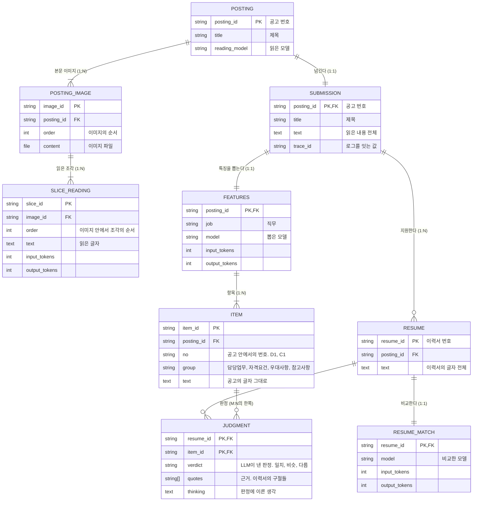

# 영속 데이터

계속 보관하는 데이터와 그 관계. 근거는 `03_prd/prd.md`의 5장, 7~10장이다. 어떤 기술에 담을지는 `08_infra`에서 정한다.

## 1. 데이터와 관계

- 고객사 쪽: `POSTING`, `POSTING_IMAGE`, `SLICE_READING`. 경계: `SUBMISSION`. 서비스 제공사 쪽: 나머지.
- 두 쪽을 건너가는 것은 `SUBMISSION` 하나뿐이다. 이미지는 건너가지 않는다(`03_prd/prd.md` 8.3).
- `SUBMISSION.text`는 `SLICE_READING.text`를 이미지의 순서, 조각의 순서대로 이어 붙인 것이다.
- `JUDGMENT`는 조건(자격요건, 우대사항, 참고사항)에만 있다. 담당업무에는 없다.

## 2. 이렇게 구성한 근거

| 구성 | 근거 |
| :- | :- |
| 고객사 쪽과 서비스 제공사 쪽을 나누고 `SUBMISSION`으로만 잇는다 | 서비스 제공사는 사람인에 접속하지 않고 이미지도 받지 않는다(`03_prd/prd.md` 1장, 4장). 그림에서 `SUBMISSION`을 건너는 선이 하나뿐이라는 것으로 이것이 보인다 |
| `POSTING`과 `SUBMISSION`은 1:1인데 합치지 않는다 | 가진 쪽이 다르다. `POSTING`은 고객사 쪽에 남고 `SUBMISSION`은 넘어간다. 합치면 무엇이 넘어가는지가 흐려진다 |
| 읽은 결과를 통째가 아니라 조각(`SLICE_READING`)마다 둔다 | LLM을 조각마다 한 번 부른다(`03_prd/prd.md` 8.2). 비용과 실패가 조각 단위로 생긴다. 읽은 내용 전체는 조각을 이어 붙이면 나온다 |
| `FEATURES`는 공고마다 하나다. 이력서마다 두지 않는다 | 지원자마다 조건이 다르게 뽑히면 랭킹이 공정하지 않다(`03_prd/prd.md` 9.2) |
| 담당업무와 조건을 `ITEM` 하나에 두고 `group`으로 가른다 | 모양이 같다(공고의 글자 그대로, 읽은 내용과 대조). 그룹은 코드가 바꿀 수 있는 값이다(개인 사정은 참고사항으로 고정, `03_prd/prd.md` 9.3). 그룹마다 테이블을 나누면 그룹이 바뀔 때 옮겨야 한다 |
| `RESUME`이 공고에 속한다 | 이 과제에서는 공고마다 이력서 6개가 주어진다(`03_prd/prd.md` 1장). 한 지원자가 여러 공고에 지원하는 것은 다루지 않는다. 그래서 1:N이고 `posting_id`를 FK로 갖는다 |
| `RESUME_MATCH`와 `JUDGMENT`를 나눈다 | 단위가 다르다. LLM 호출은 이력서마다 한 번이고(모델, 토큰 수), 판정은 조건마다 하나다(`03_prd/prd.md` 10.1) |
| `JUDGMENT`에는 LLM이 낸 그대로(판정, 근거, 생각)만 둔다 | LLM이 낸 것은 다시 만들면 비용이 들고 달라진다. 그 밖의 것(대조 결과, 점수에 쓰는 판정)은 여기서 코드로 나온다. 낸 그대로를 남겨야 대조의 규칙을 고쳐도 LLM을 다시 부르지 않는다 |
| 근거(`quotes`)를 따로 떼지 않고 `JUDGMENT` 안에 목록으로 둔다 | 근거는 늘 그 판정과 함께 읽는다. 근거만 따로 찾는 일이 없다 |
| 1:1인 것(`POSTING`과 `SUBMISSION`, `SUBMISSION`과 `FEATURES`, `RESUME`과 `RESUME_MATCH`)은 부모의 PK를 자식의 PK이자 FK로 쓴다 | PK는 중복될 수 없어 1:1이 구조로 보장된다. 관계 테이블을 두면 조인만 늘어난다(`AGENTS.md`의 판단하는 조건) |
| `JUDGMENT`는 `RESUME`과 `ITEM` 사이의 관계 테이블이다. 양쪽의 키를 합친 것이 PK다 | 이력서 하나가 조건 여럿과, 조건 하나가 이력서 여럿과 이어진다(M:N). 판정은 그 한 쌍마다 하나다 |
| 1:N인 자식(`POSTING_IMAGE`, `SLICE_READING`, `ITEM`, `RESUME`)은 자기만의 PK를 갖고 부모의 키는 FK로 둔다 | 부모의 키가 자식에 여러 번 들어가야 한다(`AGENTS.md`의 판단하는 조건). 자기만의 PK가 있어서 `JUDGMENT`가 이력서와 항목을 키 하나씩으로 가리킨다 |
| `ITEM`에 `item_id`와 따로 `no`(C1, D1)를 둔다 | `item_id`는 가리키기 위한 값이고 뜻이 없다. `no`는 화면에 보여 주고 LLM과 주고받는, 공고 안에서의 번호다 |

### 2.1 읽는 길(조인)에서 본 구성

구성은 데이터를 어떻게 읽는지에 맞춰야 한다. 읽는 길은 화면의 요청 셋이다(`04_wireframe/wireframe.html`의 구역).

| 읽는 일 | 잇는 데이터 | 잇는 키 |
| :- | :- | :- |
| 공고의 목록 (①) | `SUBMISSION` ⋈ `FEATURES` | `posting_id` |
| 공고에서 뽑은 것 (②) | `SUBMISSION` ⋈ `FEATURES` ⋈ `ITEM` | `posting_id` |
| 랭킹 (③) | `ITEM` ⋈ `JUDGMENT` | `item_id`. 공고는 `ITEM.posting_id`로 고른다 |
| 지원자 한 명의 근거와 원문 (④ ⑤ ⑥) | `RESUME` ⋈ `JUDGMENT` ⋈ `ITEM` | `resume_id`, `item_id` |

- 랭킹은 판정(`JUDGMENT`)과 그 조건의 그룹(`ITEM`)만 있으면 계산된다. `JUDGMENT`가 `item_id`를 직접 갖고 있어서 `ITEM`과 바로 이어진다. 공고 하나의 것은 `ITEM.posting_id`로 고른다.
- 지원자 한 명의 것은 `resume_id` 하나로 집어낸다. `resume_id`가 전체에서 고유하므로 공고 번호를 함께 댈 필요가 없다.
- 1:1인 것(`SUBMISSION`과 `FEATURES`, `RESUME`과 `RESUME_MATCH`)은 키가 같아서 잇는 비용이 없다. 합치지 않은 이유는 2장에 있다.
- 이력서의 글자(`RESUME.text`)는 ④ ⑤ ⑥에서만 읽는다. 랭킹을 낼 때는 읽지 않는다. 판정과 떨어져 있어서 그렇게 할 수 있다.

## 3. 저장하는 기준과 저장하지 않는 것

저장해야 하는 것만 저장한다. 기준은 셋이다. 하나라도 해당해야 저장한다.

| 기준 | 해당하는 필드 |
| :- | :- |
| 다시 만들 수 없거나, 다시 만들면 비용이 들고 달라진다 | 본문 이미지, LLM이 낸 것(읽은 글자, 직무, 항목, 판정, 근거, 생각) |
| 화면이 보여 주거나 뒤의 단계가 입력으로 쓴다 | 제목, 읽은 내용, 이력서의 글자, 항목의 그룹, 판정의 생각 |
| 데이터를 가리키거나 잇는 데 쓴다 | 키, 순서(이미지, 조각), 항목의 번호(`no`), trace id |

모델과 토큰 수는 첫째 기준에 딸린 것이다. 그 결과를 만드는 데 얼마가 들었는지(예산, `03_prd/prd.md` 5장)와 어느 모델의 결과인지는 다시 알아낼 수 없다.

| 저장하지 않는 것 | 이유 |
| :- | :- |
| 점수와 순위 | `JUDGMENT`에서 코드가 계산한다. 저장하면 식을 고쳤을 때 판정과 어긋난다 |
| 대조 결과(항목이 읽은 내용 안에 있는가, 근거가 이력서 안에 있는가) | 저장된 글자끼리 코드로 견주면 나온다. 저장하면 대조의 규칙을 고쳤을 때 어긋난다 |
| 점수에 쓰는 판정 | LLM이 낸 판정과 대조 결과에서 나온다 |
| LLM이 그룹을 고르기 전에 쓴 생각과 종류, 공고의 칸 목록, 직무를 어디서 얻었는지 | 결과물이 아니라 그룹을 맞게 고르기 위한 과정이다(`03_prd/prd.md` 9.2). 화면도 뒤의 단계도 쓰지 않는다. 종류는 그룹을 정할 때 한 번 쓰고 끝난다 |
| 조각을 자른 자리 | 이미지에서 코드로 다시 계산하면 늘 같은 값이 나온다 |
| 피드백, 사용자 | 만들지 않는다(`03_prd/prd.md` 3.2) |

## 4. 예상되는 양

근거는 `03_prd/prd.md` 5장(공고 2개, 공고마다 이력서 6개)과 실제로 잰 값이다.

| 데이터 | 수 | 크기 |
| :- | :- | :- |
| `POSTING`, `SUBMISSION`, `FEATURES` | 각 2 | 넘긴 것 약 9KB, 특징 약 8KB |
| `POSTING_IMAGE` | 4 | 약 7MB |
| `SLICE_READING` | 18 | 약 12KB |
| `ITEM` | 23 | |
| `RESUME`, `RESUME_MATCH` | 각 12 | 비교 약 40KB |

- 공고의 수 P, 공고당 조각 S, 지원자 N, 조건 C일 때 `SLICE_READING`은 P × S, `JUDGMENT`는 P × N × C로 늘어난다.
- 실행할 때 한 번 쓰고 그 뒤로는 읽기만 한다.

## 5. 아직 정하지 않은 것

- 이력서의 형식(`CHECKLIST.md`). 지금은 글자 전체를 한 덩어리로 둔다.
