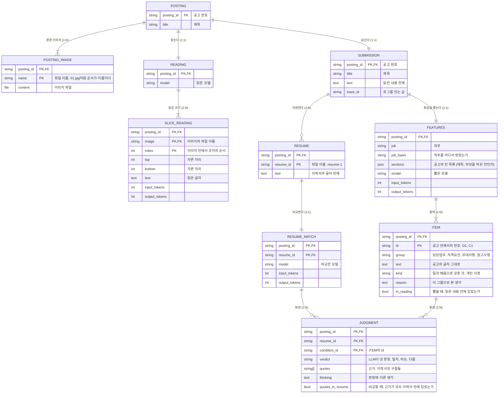

# 영속 데이터

계속 보관하는 데이터와 그 관계. 근거는 `03_prd/prd.md`의 5장, 7~10장이다. 어떤 기술에 담을지는 `08_infra`에서 정한다.

## 1. 데이터와 관계

지금의 코드가 저장하는 그대로다.

- 고객사 쪽: `POSTING`, `POSTING_IMAGE`, `READING`, `SLICE_READING`. 경계: `SUBMISSION`. 서비스 제공사 쪽: 나머지.
- 두 쪽을 건너가는 것은 `SUBMISSION` 하나뿐이다. 이미지는 건너가지 않는다(`03_prd/prd.md` 8.3).
- `SUBMISSION.text`는 `SLICE_READING.text`를 이미지의 순서, 조각의 순서대로 이어 붙인 것이다. 같은 글자를 고객사 쪽에 글자 파일(`reading.txt`)로도 둔다. 사람이 열어 보기 위한 것이다.
- `JUDGMENT`는 조건(자격요건, 우대사항, 참고사항)에만 있다. 담당업무에는 없다.
- 항목의 번호(`id`)와 이력서의 번호(`resume_id`)는 공고 안에서만 고유하다. 전체에서 고유한 값은 저장하지 않는다. 화면에 내보낼 때 API가 공고 번호를 앞에 붙여 만든다(`{공고 번호}-C1`, `{공고 번호}-resume-1`, `07_api/request-response/request-response.md`).

## 2. 이렇게 구성한 근거

| 구성 | 근거 |
| :- | :- |
| 고객사 쪽과 서비스 제공사 쪽을 나누고 `SUBMISSION`으로만 잇는다 | 서비스 제공사는 사람인에 접속하지 않고 이미지도 받지 않는다(`03_prd/prd.md` 1장, 4장). 그림에서 `SUBMISSION`을 건너는 선이 하나뿐이라는 것으로 이것이 보인다 |
| `POSTING`과 `SUBMISSION`은 1:1인데 합치지 않는다 | 가진 쪽이 다르다. `POSTING`은 고객사 쪽에 남고 `SUBMISSION`은 넘어간다. 합치면 무엇이 넘어가는지가 흐려진다 |
| 읽은 결과를 통째가 아니라 조각(`SLICE_READING`)마다 둔다 | LLM을 조각마다 한 번 부른다(`03_prd/prd.md` 8.2). 비용과 실패가 조각 단위로 생긴다. 읽은 내용 전체는 조각을 이어 붙이면 나온다 |
| `FEATURES`는 공고마다 하나다. 이력서마다 두지 않는다 | 지원자마다 조건이 다르게 뽑히면 랭킹이 공정하지 않다(`03_prd/prd.md` 9.2) |
| 담당업무와 조건을 `ITEM` 하나에 두고 `group`으로 가른다 | 모양이 같다(공고의 글자 그대로, 읽은 내용과 대조). 그룹은 코드가 바꿀 수 있는 값이다(개인 사정은 참고사항으로 고정, `03_prd/prd.md` 9.3) |
| `RESUME`이 공고에 속한다 | 이 과제에서는 공고마다 이력서 6개가 주어진다(`03_prd/prd.md` 1장). 한 지원자가 여러 공고에 지원하는 것은 다루지 않는다 |
| `RESUME_MATCH`와 `JUDGMENT`를 나눈다 | 단위가 다르다. LLM 호출은 이력서마다 한 번이고(모델, 토큰 수), 판정은 조건마다 하나다(`03_prd/prd.md` 10.1). 파일로는 이력서 하나의 파일 안에 판정의 목록으로 함께 있다 |
| 근거(`quotes`)를 따로 떼지 않고 `JUDGMENT` 안에 목록으로 둔다 | 근거는 늘 그 판정과 함께 읽는다. 근거만 따로 찾는 일이 없다 |
| 자식의 키는 공고 번호와 공고 안에서의 번호를 합친 것이다(이미지의 파일 이름, 항목의 `id`, 이력서의 `resume_id`) | 저장하는 곳이 공고 번호를 이름으로 하는 폴더다. 폴더가 공고 번호의 자리를 맡는다. LLM과 주고받는 번호(C1)를 그대로 키로 써서 바꾸는 단계가 없다 |
| 이미지와 조각에 따로 번호를 만들지 않는다 | 순서가 곧 이름이다(`01.jpg`, 조각의 `index`). 가리키는 곳이 읽기 하나뿐이다 |

### 2.1 읽는 길(조인)에서 본 구성

읽는 길은 화면의 요청 셋이다(`04_wireframe/wireframe.html`의 구역).

| 읽는 일 | 잇는 데이터 | 잇는 키 |
| :- | :- | :- |
| 공고의 목록 (①) | `FEATURES` ⟕ `SUBMISSION` | `posting_id`. 넘긴 것이 없어도 특징이 있으면 목록에 나온다 |
| 공고에서 뽑은 것 (②) | `FEATURES` ⋈ `ITEM` ⟕ `SUBMISSION` | `posting_id` |
| 랭킹 (③) | `ITEM` ⋈ `JUDGMENT` | `posting_id`, `ITEM.id` = `JUDGMENT.condition_id` |
| 지원자 한 명의 근거와 원문 (④ ⑤ ⑥) | `RESUME` ⋈ `JUDGMENT` ⋈ `ITEM` | `posting_id`, `resume_id`, `condition_id` |

- 랭킹은 판정(`JUDGMENT`)과 그 조건의 그룹(`ITEM`)만 있으면 계산된다.
- 지원자 한 명의 요청은 화면이 받은 번호(`{공고 번호}-resume-1`) 하나로 온다. 서버는 그 번호를 쪼개지 않고, 공고마다 이력서의 번호를 같은 방법으로 만들어 견주어 찾는다. 공고와 이력서의 수가 적어서 그렇게 한다.
- 이력서의 글자(`RESUME.text`)는 ④ ⑤ ⑥과, 랭킹에서 가린 이름을 얻을 때 읽는다.

## 3. 저장하는 것과 저장하지 않는 것

| 저장하는 이유 | 해당하는 필드 |
| :- | :- |
| 다시 만들 수 없거나, 다시 만들면 비용이 들고 달라진다 | 본문 이미지, LLM이 낸 것(읽은 글자, 직무, 직무를 어디서 얻었는지, 칸의 목록, 항목과 그 종류와 생각, 판정, 근거, 생각) |
| 화면이 보여 주거나 뒤의 단계가 입력으로 쓴다 | 제목, 읽은 내용, 이력서의 글자, 항목의 그룹, 판정의 생각 |
| 데이터를 가리키거나 잇는 데 쓴다 | 공고 번호, 이미지의 파일 이름, 조각의 순서, 항목의 번호, 이력서의 번호, trace id |
| 만들 때 계산한 것을 함께 둔다 | 대조 결과(`in_reading`, `quotes_in_resume`), 조각을 자른 자리(`top`, `bottom`) |

- 모델과 토큰 수는 첫째 이유에 딸린 것이다. 그 결과를 만드는 데 얼마가 들었는지(예산, `03_prd/prd.md` 5장)와 어느 모델의 결과인지는 다시 알아낼 수 없다.
- 넷째 줄은 저장하지 않아도 다시 계산할 수 있는 값이다. 저장해 둔 탓에 대조의 규칙을 고치면 저장된 값과 어긋날 수 있다. 그래서 `in_reading`은 넘겨받은 읽은 내용이 있으면 응답을 만들 때 다시 계산한다. `quotes_in_resume`은 저장된 값을 그대로 쓴다. 2026-10-11에 대조의 규칙을 고친 뒤 저장된 판정 전체를 다시 견주었고 달라진 것이 없었다.
- LLM이 그룹을 고르기 전에 쓴 생각(`reason`), 종류(`kind`), 칸의 목록(`sections`), 직무를 어디서 얻었는지(`job_basis`)는 결과물이 아니라 과정이다. 화면도 뒤의 단계도 쓰지 않는다. 저장은 하고 있다.

| 저장하지 않는 것 | 이유 |
| :- | :- |
| 점수와 순위 | `JUDGMENT`에서 코드가 계산한다. 저장하면 식을 고쳤을 때 판정과 어긋난다 |
| 점수에 쓰는 판정, 화면의 표시 | LLM이 낸 판정과 대조 결과에서 나온다 |
| 전체에서 고유한 번호(`item_id`, 화면의 `resume_id`), 가린 이름 | API가 응답을 만들 때 만든다 |
| 피드백, 사용자 | 만들지 않는다(`03_prd/prd.md` 3.2) |

## 4. 예상되는 양

근거는 `03_prd/prd.md` 5장(공고 2개, 공고마다 이력서 6개)과 실제로 잰 값이다.

| 데이터 | 수 | 크기 |
| :- | :- | :- |
| `POSTING`, `SUBMISSION`, `FEATURES` | 각 2 | 넘긴 것 약 9KB, 특징 약 8KB |
| `POSTING_IMAGE` | 4 | 약 7MB |
| `SLICE_READING` | 18 | 약 12KB |
| `ITEM` | 23 | |
| `RESUME`, `RESUME_MATCH` | 각 12 | 비교 약 40KB |

- 공고의 수 P, 공고당 조각 S, 지원자 N, 조건 C일 때 `SLICE_READING`은 P × S, `JUDGMENT`는 P × N × C로 늘어난다.
- 실행할 때 한 번 쓰고 그 뒤로는 읽기만 한다.

## 5. 아직 정하지 않은 것

- 이력서의 형식(`CHECKLIST.md`). 지금은 글자 전체를 한 덩어리로 둔다.
