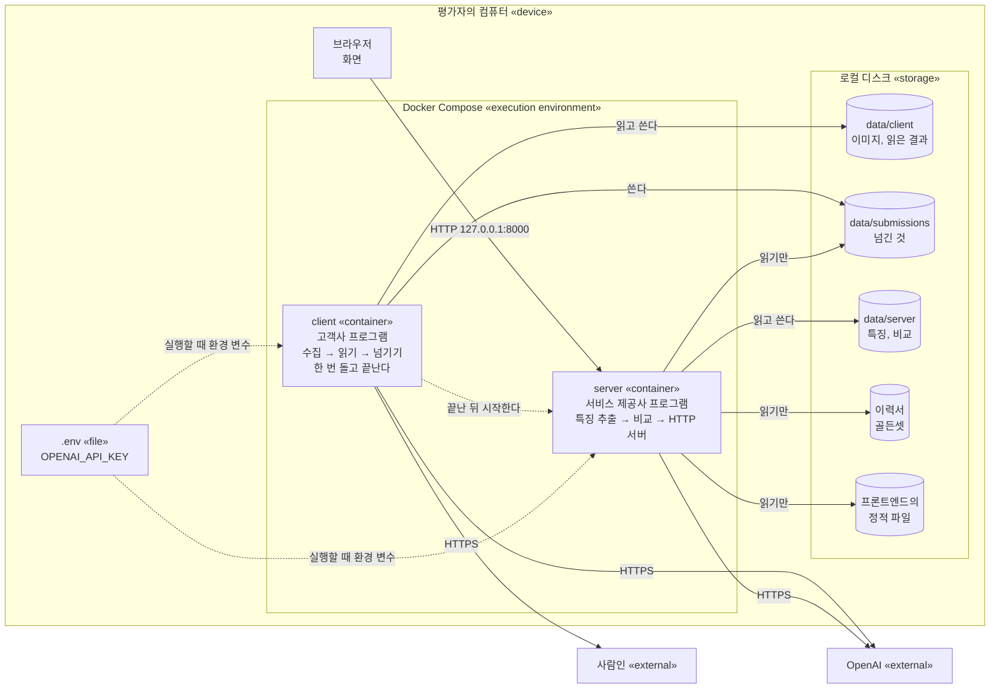

# 인프라 구조

앞 단계에서 정한 성격을 담을 기술과 구성을 적은 문서. 근거는 `06_data-model`, `07_api`, `03_prd/prd.md`의 5장, 13장이다.

**3~5장과 6.2는 에이전트의 추천안이다. 사용자가 정하지 않았다.** 사용자가 정한 것은 2장과 6.1에 적었다.

## 1. 앞 단계에서 받은 성격

| 앞 단계 | 성격 | 필요한 것 |
| :- | :- | :- |
| `06_data-model/persistent` | 공고 2개, 이력서 12개. 실행할 때 한 번 쓰고 그 뒤로 읽기만 한다. 이미지 파일이 있다 | 파일을 담을 곳 |
| `06_data-model/volatile` | 없다 | 메모리 DB를 두지 않는다 |
| `06_data-model/event` | 없다 | pub/sub을 두지 않는다 |
| `07_api/request-response` | 읽기(GET) 3개. 사용자 한 명 | HTTP 서버 하나 |
| `07_api/server-push`, `bidirectional` | 없다 | 두지 않는다 |
| `07_api/external` | 사람인, OpenAI | 바깥으로 나가는 네트워크, OpenAI 키 |
| `07_api/background` | 실행할 때 한 번 도는 작업 둘. 순서가 있다 | 순서대로 실행하는 장치 |

## 2. 사용자가 정한 것

- 인프라는 원래 GCP나 AWS 같은 클라우드로 해야 한다. 그러나 지금은 로컬 기반이므로, Docker Compose에서 가능한 선으로 만든다(사용자, 2026-10-11).
- Docker Compose로 띄운다. 평가자는 명령 하나로 실행한다.
- 로컬 구성만 만든다. 클라우드 구성과 CI/CD는 만들지 않는다. 평가자에게 계정과 키가 필요해지고, 배포할 곳이 없기 때문이다.
- OpenAI 키는 루트의 `.env`에 둔다.
- 서비스 제공사 쪽 결과(특징, 비교)를 저장소에 넣는다. 수집이 실패해도 화면이 나오게 하려는 것이다(6.1).

## 3. 고른 기술

| 필요한 것 | 고른 것 | 이유 | 버린 것 |
| :- | :- | :- | :- |
| 영속 데이터를 담을 곳 | 로컬 디스크의 파일(JSON, 이미지) | 양이 적고 동시에 쓰는 일이 없다. 관계는 공고 번호와 이력서 번호로 된 경로로 충분히 나타난다. 평가자가 결과를 파일로 열어 볼 수 있다 | 관계형 DB. 컨테이너와 스키마 관리가 늘어나는데 이 양에서는 얻는 것이 없다 |
| HTTP 서버 | 파이썬 표준 라이브러리의 HTTP 서버 | 읽기 3개, 사용자 한 명이다. 지금 백엔드는 OpenAI도 표준 라이브러리로 부른다. 의존성이 늘지 않는다 | 웹 프레임워크. 엔드포인트가 늘면 그때 바꾼다 |
| 화면을 주는 곳 | 같은 HTTP 서버가 프론트엔드의 정적 파일을 준다 | 주소와 포트가 하나다. 화면과 API의 출처가 같아 출처를 넘는 설정이 필요 없다 | 프론트엔드용 웹 서버 컨테이너 |
| 순서대로 실행하는 장치 | Docker Compose의 `depends_on` | 고객사 프로그램이 끝난 뒤 서비스 제공사 프로그램이 시작한다 | 작업 큐 |

## 4. 구성

무엇이 어디에 올라가고 무엇과 이어지는지를 배치 다이어그램으로 그린다.

- 컨테이너를 둘로 나눈 이유는 프로그램이 둘이기 때문이다(`03_prd/prd.md` 1장). 두 컨테이너가 함께 보는 폴더는 `data/submissions` 하나뿐이다. `server`에서 `data/client`로 가는 선이 없다. 그래서 이미지가 서비스 제공사 쪽으로 넘어가지 않는다는 것이 구성으로 지켜진다.
- `server`에서 사람인으로 가는 선이 없다. 서비스 제공사는 사람인에 접속하지 않는다.
- `server`는 `client`가 실패로 끝나도 시작한다. 저장된 결과가 있으면 그것으로 화면을 보여 줄 수 있기 때문이다.
- 포트는 `127.0.0.1`에만 연다. 인증이 없어서 같은 네트워크의 다른 컴퓨터에 열지 않는다.
- 두 컨테이너는 백엔드의 같은 이미지를 쓰고 실행하는 명령만 다르다.
- 컨테이너는 root가 아닌 사용자로 실행한다. 쓸 일이 없는 폴더(그림의 "읽기만")는 읽기 전용으로 붙인다.
- OpenAI 키는 실행할 때 `.env`에서 환경 변수로 넣는다. 이미지를 만들 때 넣지 않는다. `.env`는 이미지를 만드는 재료에서도 뺀다.
- 로그는 표준 출력으로 낸다. `docker compose logs`로 본다(`11_log`).

## 5. 저장 구조

`data/`는 인프라의 로컬 구성(`13_code/infra/local/`) 아래에 있다.

| 경로 | 데이터 (`06_data-model/persistent`) | 쓰는 쪽 |
| :- | :- | :- |
| `data/client/postings/{공고 번호}/posting.json` | 공고: `posting_id`, `title` | client |
| `data/client/postings/{공고 번호}/{image_id}.{jpg,png}` | 본문 이미지. 순서는 `posting.json`의 `images[]`(`image_id`, `order`)에 둔다 | client |
| `data/client/readings/{공고 번호}/reading.json` | 읽은 결과: `posting_id`, `model`(`POSTING`의 읽은 모델), `slices[]`(`slice_id`, `image_id`, `order`, `text`, `input_tokens`, `output_tokens`) | client |
| `data/submissions/{공고 번호}.json` | 넘긴 것: `posting_id`, `title`, `text`, `trace_id` | client |
| `data/server/features/{공고 번호}.json` | 특징: `posting_id`, `model`, `job`, `items[]`(`item_id`, `no`, `group`, `text`), `input_tokens`, `output_tokens` | server |
| `data/server/matches/{공고 번호}/{이력서 번호}.json` | 비교: `resume_id`, `model`, `judgments[]`(`item_id`, `thinking`, `quotes[]`, `verdict`), `input_tokens`, `output_tokens` | server |
| `12_test-scenario/golden-set/{공고 번호}/{이력서 번호}.md` | 이력서. 폴더가 `posting_id`(FK)이고 파일 이름이 `resume_id`다 | 사람 |

- 경로의 폴더는 FK의 역할을 한다. 공고 하나의 것(이력서, 비교)을 폴더 하나로 집어낸다. 판정과 조건은 `item_id`로 잇는다(`06_data-model/persistent/persistent.md` 2.1).
- 키의 값은 전체에서 겹치지 않는 문자열이다. `image_id`, `slice_id`, `item_id`는 만들 때 프로그램이 정한다. `resume_id`는 이력서의 파일 이름이다. 그래서 이력서의 파일 이름은 공고가 달라도 겹치면 안 된다.
- 키의 값에는 뜻이 없다. 읽는 쪽은 키를 쪼개서 쓰지 않는다. 화면에 보여 줄 번호는 `no`에 따로 있다.
- 파일이 있으면 그 단계를 건너뛴다. 처음부터 다시 만들려면 그 파일을 지운다.
- 항목의 `no`는 담당업무가 `D1`부터, 조건이 `C1`부터다.

## 6. 크롤링의 재현과 예산

### 6.1 크롤링의 재현

평가 시점에 공고가 마감되었거나 사람인이 접속을 막으면 수집이 실패한다. 55240017은 2026-10-18에 마감된다.

| 선택지 | 얻는 것 | 잃는 것 |
| :- | :- | :- |
| A. 아무것도 저장소에 넣지 않는다 | 저장소에 공고의 글자와 이미지가 없다. 평가자가 크롤링부터 끝까지 실제로 도는 것을 본다 | 수집이 실패하면 화면에 아무것도 나오지 않는다 |
| B. 서비스 제공사 쪽 결과(특징, 비교)만 넣는다 | 수집이 실패해도 화면이 나온다. 평가자의 비용이 줄어든다 | 담당업무와 조건의 글자(공고의 구절 23줄)가 public 저장소에 들어간다. 저장된 결과가 있으면 LLM을 부르지 않으므로, 평가자가 지우지 않으면 특징 추출과 비교가 실제로 도는 것을 보지 못한다 |
| C. 이미지와 읽은 결과까지 다 넣는다 | 수집이 실패해도 읽기부터 다시 돌릴 수 있다 | 공고의 이미지와 글자 전체가 public 저장소에 들어간다. 조사에서 넣지 않기로 한 것이다(`02_research/crawling/crawling.md`) |

- **사용자가 B로 정했다(2026-10-11).** 수집이 실패해도 화면이 나와야 하기 때문이다. 조건의 글자가 public 저장소에 들어가는 것은 알고 골랐다. 이미지와 읽은 내용 전체, 넘긴 것은 넣지 않는다.
- 저장소에 넣는 것은 `data/server/features/`와 `data/server/matches/`다. 인프라 서브모듈의 `.gitignore`가 `data/` 가운데 이 둘만 남긴다.
- 넣기 전에 두 폴더에서 키, 전화번호, 메일 주소의 모양을 검색했고 나오지 않았다.
- 평가자가 특징 추출과 비교가 실제로 도는 것을 보려면 두 폴더의 파일을 지우고 실행한다. README의 "실행 방법"에 적는다.

### 6.2 예산

- 처음부터 끝까지 한 번 실행하는 데 약 $0.04가 든다(`07_api/external/external.md` 4장). 저장된 결과가 다 있으면 $0다.
- 예산은 약 $5다. 지금까지 쓴 금액은 `CHECKLIST.md`에 적혀 있다. 남은 금액은 계산하지 않았다.
- 정할 것은 평가자가 실행할 몫으로 얼마를 남길지다.

## 7. CI/CD

만들지 않는다(2장). 그래서 어느 브랜치에서 무엇을 돌리는지도 정하지 않는다.
