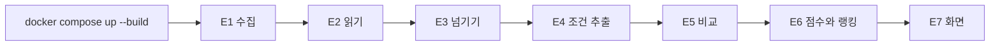

# 테스트 시나리오

코드의 완성 조건을 적은 문서. 근거는 `03_prd/prd.md`의 3장(기능)과 5장(성능), `10_security/security.md`의 5장, `golden-set/`이다.

완성 조건은 한 부분이 아니라 **명령 하나로 수집부터 화면까지 이어지는 것**이다. 아래 시나리오는 2026-10-11에 `result/`에서 모두 확인했다. 화면의 시나리오(E7, E10~E12)는 헤드리스 브라우저로 눌러 확인했다.

## 1. 처음부터 끝까지

| 번호 | 시나리오 | 기대하는 것 | 요구사항 | 결과 |
| :- | :- | :- | :- | :- |
| E1 | 공고 번호 두 개로 실행한다 | 공식 API 없이 제목과 본문 이미지를 가져온다 | F1 | 통과. 이미지 3장과 1장 |
| E2 | 가져온 이미지를 읽는다 | 글자로 읽고 저장한다. 다시 실행하면 다시 읽지 않는다 | F2 | 통과. 3,469자와 579자 |
| E3 | 넘긴 것의 파일을 연다 | 공고 번호, 제목, 읽은 내용만 있다. 이미지는 없다 | F3 | 통과 |
| E4 | 두 공고의 조건을 본다 | 직무, 담당업무, 자격요건, 우대사항, 참고사항으로 나뉜다. 모든 항목이 읽은 내용 안에 글자 그대로 있다 | F4, F6 | 통과 |
| E5 | 이력서 12명을 비교한다 | 조건마다 판정과 근거가 있다. 실패한 비교가 없다 | F5 | 통과. 12명 성공, 실패 0 |
| E6 | 공고의 랭킹을 부른다 | 0~100점이고 높은 순서다. 같은 점수는 같은 순위다 | F7, F9 | 통과 |
| E7 | 브라우저로 화면을 열고 지원자를 누른다 | 조건, 랭킹, 근거, 이력서 원문이 나란히 보인다 | F8 | 통과 |
| E8 | 키 없이 실행한다 | 수집과 읽기는 실패해도 저장된 결과로 조건과 랭킹이 나온다. "공고 원문" 탭에는 읽은 내용이 없다고 나온다 | F10, F12 | 통과. 이때 공고의 탭에는 제목 대신 직무가 나온다 |
| E9 | 저장된 결과가 다 있는 상태에서 다시 실행한다 | LLM을 부르지 않는다 | 5장 | 통과. 호출 0번 |

| E10 | 가운데 칸의 "공고 원문" 탭을 누른다 | 공고를 읽은 내용이 나오고, 뽑은 담당업무와 조건의 자리가 번호와 함께 모두 표시된다. 표시의 수와 찾지 못했다고 말한 수를 더하면 뽑은 항목의 수와 같다. 오른쪽 칸의 이력서 원문은 그대로다 | F12 | 통과. 회계 11곳, 마케팅 12곳. 새로 읽은 실행에서는 마케팅이 11곳이었고, 찾지 못한 하나(D4)를 화면이 번호로 말한다 |
| E11 | 지원자의 목록을 본다 | 가린 이름과 이력서 번호가 보인다. 지원자를 누르면 가운데 칸과 오른쪽 칸이 그 지원자의 것으로 바뀐다 | F8, F11 | 통과 |
| E12 | 화면을 처음 연다 | 공고 번호가 큰 공고가 먼저 열려 있고 1위 지원자가 골라져 있다 | F13 | 통과 |

## 2. 골든셋의 가설

`golden-set/`의 이력서마다 검증하려는 가설이 있다. 기대는 점수가 아니라 순서로 적었다.

| 번호 | 기대하는 것 | 마케팅 | 회계 |
| :- | :- | :- | :- |
| G1 | 1번과 2번의 점수가 같다 (표현과 형태가 달라도 판정이 같다) | 통과. 100, 100 | 통과. 100, 100 |
| G2 | 3번, 4번, 5번이 1번보다 낮다 (바꾼 한 군데만 내려간다) | 통과. 80, 90, 90 | 통과. 70, 77, 77 |
| G3 | 6번이 가장 낮다 (단어만 겹치는 사람을 걸러낸다) | 통과. 0 | 통과. 0 |
| G4 | 자격요건을 다 갖춘 3번이 4번, 5번보다 낮지 않다 | 해당 없음 | **어긋남**. 70과 77 |

- G4는 자격요건을 다 채워야 우대사항이 붙는 식(문턱)을 버리기 전의 기대다. 지금의 식은 `03_prd/prd.md` 10.2다. 골든셋은 결과에 맞춰 고치지 않는다.

## 3. 코드의 규칙 (자동 테스트 54개)

LLM을 부르지 않는다. `docker compose run --rm --no-deps server python -m unittest discover -s tests`로 돌린다.

| 번호 | 확인하는 것 | 파일 |
| :- | :- | :- |
| U1 | 근거의 글자가 하나만 달라도, 떨어진 구절을 이어 붙여도 믿지 않는다. 눈으로 같은 글자의 유니코드 표기 차이는 다르다고 하지 않는다 | `test_checks.py` |
| U11 | 로그: LLM을 부르면 `llm.called`에 토큰 수와 비용이 남고, 저장된 결과를 쓰면 `stage.skipped`가 남는다. 넘겨받은 trace id를 이어 쓴다. 대조에 실패한 것은 번호만 남는다 | `test_logging.py` |
| U10 | 조건이 읽은 내용 안에 있는지는 응답을 만들 때 넘겨받은 읽은 내용으로 다시 계산한다 | `test_api.py` |
| U2 | 개인 사정은 공고가 필수 칸에 적었어도 참고사항이다 | `test_checks.py` |
| U3 | 긴 이미지를 자를 때 글자가 있는 줄을 가로지르지 않는다 | `test_checks.py` |
| U4 | 점수의 값: 다 갖추면 100, 자격요건만 다 갖추면 70, 하나가 비슷이면 88, 하나가 빠지면 77 | `test_scoring.py` |
| U5 | 점수의 성질: 0~100 안에 있다. 판정이 좋아지면 내려가지 않는다. 다른 지원자에 따라 달라지지 않는다 | `test_scoring.py` |
| U6 | 근거를 확인하지 못한 판정과 빠진 판정은 0점이다. 참고사항은 점수를 바꾸지 않는다 | `test_scoring.py` |
| U7 | API: 랭킹의 순서, 화면의 표시(이력서에 적혀 있지 않음, 근거를 확인하지 못함), 없는 번호는 404, 모양이 어긋난 번호는 400 | `test_api.py` |
| U8 | 이름의 가운데를 가린다(강민재 → 강*재). 제목에서 이름을 얻지 못하면 이름이 없다 | `test_api.py` |
| U9 | 공고의 응답에 넘겨받은 읽은 내용이 들어 있다. 넘긴 것이 없으면 없다 | `test_api.py` |

## 4. 로그 (`11_log/log.md`)

| 번호 | 시나리오 | 기대하는 것 | 결과 |
| :- | :- | :- | :- |
| L1 | 두 컨테이너의 표준 출력을 본다 | 모든 줄이 JSON 하나다. `ts`, `level`, `service`, `trace_id`, `event`가 있다 | 통과. 39줄 |
| L2 | 공고 하나의 trace id로 로그를 모은다 | 고객사 프로그램의 로그와 서비스 제공사 프로그램의 로그가 같은 값으로 이어진다 | 통과. 두 공고 모두 |
| L3 | 저장된 결과가 다 있는 상태에서 실행한다 | `stage.skipped`가 남고 `llm.called`가 없다. `run.finished`의 LLM 호출 수가 0이다 | 통과. `stage.skipped` 18번 |
| L4 | 근거가 이력서에 없는 판정이 저장된 공고를 실행한다 | `quote.not_in_resume`가 번호와 함께 남는다. 구절은 남지 않는다 | 통과. 3번 |
| L5 | 로그 전체에서 키, 이력서의 구절, 읽은 내용을 찾는다 | 없다 | 통과 |

LLM을 실제로 불렀을 때의 `llm.called`는 자동 테스트(U11)로 본다. 호출을 흉내 낸 것으로 확인한다.

## 5. 보안 (`10_security/security.md` 5장)

| 번호 | 시나리오 | 기대하는 것 | 결과 |
| :- | :- | :- | :- |
| T1 | 커밋하는 파일에서 키, 전화번호, 메일 주소의 모양을 검색한다 | 나오지 않는다 | 통과 |
| T2 | 넘긴 것의 파일을 연다 | 이미지와 이미지의 경로가 없다 | 통과 |
| T3 | `server` 컨테이너에서 `data/client`를 찾고, 서버 코드에서 사람인으로 가는 요청을 찾는다 | 둘 다 없다 | 통과 |
| T5 | 이력서에 없는 구절을 근거로 낸 판정 | 다름으로 치고 "근거를 확인하지 못함"으로 표시한다 | 통과 (U6, U7) |
| T6 | 화면이 이력서의 글자를 넣는 방식을 본다 | 글자로만 넣는다(`innerHTML`을 쓰지 않는다) | 통과 |
| T7 | `GET /api/postings/../../.env`, `GET /api/resumes/..%2F..%2F.env` | 400이나 404다. 파일의 내용이 나오지 않는다 | 통과. 404, 400 |
| T8 | 모양이 어긋난 `X-Trace-Id`로 요청한다 | 그 값을 버리고 새로 만든다 | 통과 |
| T9 | 저장된 결과가 다 있는 상태에서 API를 부른다 | OpenAI 호출이 0번이다 | 통과 |
| T10 | 포트가 열린 주소를 본다 | `127.0.0.1`에만 열려 있다 | 통과 |
| T11 | `server` 컨테이너에서 넘겨받은 것과 이력서의 파일을 고친다 | 고쳐지지 않는다(읽기 전용) | 통과 |
| T12 | 실행한 뒤의 로그와 이미지에서 키와 이력서의 구절을 검색한다 | 나오지 않는다 | 통과 |
| T13 | 화면의 파일에서 바깥의 주소를 불러오는 곳을 찾는다 | 없다 | 통과 |
| T14 | 공고의 응답(랭킹)에서 지원자의 이름을 찾는다 | 가운데를 가린 이름만 있다 | 통과 |
| T15 | 저장소가 추적하는 파일에서 넘긴 것, 읽은 결과, 공고의 이미지를 찾는다 | 없다 | 통과 |
| T4 | 지시문만 있는 이력서와, 미스매칭 이력서의 끝에 지시문을 붙인 이력서를 비교한다 | 앞의 것은 0점이다. 뒤의 것은 지시문이 없을 때와 점수가 같다 | 통과. 둘 다 0점. 방어 문장이 없던 프롬프트에서는 앞의 것이 100점이었다(`14_report/2026-10-11-2146-resume-injection.html`). 한 번씩 돌린 결과다 |
